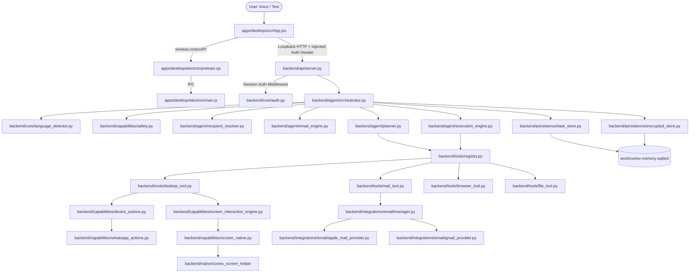

# CORTEX AGENT — COMPLETE ARCHITECTURE SPECIFICATION
**Authoritative Source-Code-Grounded System Topology, Component Boundaries, and Directory Taxonomy**
*Document Version: 1.0.0 | System Revision: Post-Screen Intelligence Integration (Milestone 12)*

---

## 1. Executive System Summary

Cortex is a supervised, local-first macOS desktop-operating AI agent built on a split-architecture design:
- **Presentation Layer:** Electron 32 + Vite 5 + React 18 frontend providing floating assistant modes, heads-up display (HUD), natural language chat, voice transcription, live execution logs, and cryptographic approval modals.
- **IPC & Transport Layer:** Restricted HTTP/JSON over loopback (`http://127.0.0.1:8765`) protected by Electron `onBeforeSendHeaders` secret injection and FastAPI session token validation.
- **Agent Intelligence Core:** Python 3.9+ orchestrator (`backend/agent/orchestrator.py`) supporting Google Gemini (`gemini-3.5-flash`), an offline heuristic rule engine, multi-language detection, autonomous planning (`backend/agent/planner.py`), policy governance (`backend/agent/policy.py`), and atomic multi-turn execution.
- **Capability Layer:** Modular system tools (Mail, Gmail, WhatsApp Desktop, macOS Finder/Filesystem, Chrome/Safari, Notes, Reminders, System Shell, Screen Intelligence) executing across AppleScript, PyObjC, and a compiled native Swift helper (`backend/native/cortex_screen_helper`).
- **Persistence Layer:** Relational SQLite 3 database (`cortex-memory.sqlite3`) running under write-ahead logging (WAL), enforcing strict foreign keys, optimistic concurrency versioning, cryptographic payload hash binding, and AES-256 encrypted memory storage.

---

## 2. Complete Project Structure & Directory Taxonomy

Below is the verified repository folder and file tree (excluding `node_modules`, `.git`, `.pytest_cache`, and ephemeral build artifacts):

```
.
├── .env                                  # Environment secrets (GEMINI_API_KEY, CORTEX_SESSION_SECRET)
├── .env.example                          # Environment template
├── .gitignore                            # Version control exclusion rules
├── .memory_key                           # AES-256 Fernet master encryption key for EncryptedMemoryStore
├── .session_secret                       # Secret token used for loopback HTTP request validation
├── README.md                             # Project overview and run directives
├── package.json                          # Monorepo root package configuration
├── package-lock.json                     # Monorepo locked NPM dependencies
├── requirements.txt                      # Top-level Python dependency specification
├── start-cortex.sh                       # Production boot script (starts FastAPI + Electron)
│
├── apps/
│   └── desktop/                          # Electron & React Desktop Application
│       ├── electron/
│       │   ├── main.js                   # Electron main process (lifecycle, windows, global shortcuts, header auth)
│       │   └── preload.cjs               # Secure ContextBridge isolation layer exposing window.cortexAPI
│       ├── src/
│       │   ├── App.jsx                   # React root component (chat UI, voice visualizer, task cards, approvals)
│       │   ├── main.jsx                  # React DOM mount point
│       │   └── styles.css                # macOS visual vibrancy, dark/light themes, typography
│       ├── index.html                    # Desktop HTML template
│       ├── package.json                  # Desktop frontend NPM dependencies (Electron, React, Lucide)
│       └── vite.config.js                # Vite build configuration (port 5173, React plugin)
│
├── backend/                              # Python Agent Engine & Backend Services
│   ├── __init__.py
│   ├── requirements.txt                  # Python dependencies (fastapi, uvicorn, speechrecognition, etc.)
│   ├── agent/                            # Autonomous Decision-Making & Orchestration Core
│   │   ├── __init__.py
│   │   ├── email_engine.py               # Professional email generation, tone adaptation, QC checks
│   │   ├── execution_engine.py           # Multi-step execute-observe-verify-recover execution engine
│   │   ├── orchestrator.py               # Central CortexOrchestrator state machine, intent routing, approval gates
│   │   ├── planner.py                    # Autonomous multi-step task decomposition (AutonomousPlanner)
│   │   ├── policy.py                     # Security risk classification, safety policies, command permissions
│   │   └── recipient_resolver.py         # Contact & email disambiguation engine with privacy controls
│   ├── api/                              # REST & Voice Gateway
│   │   ├── __init__.py
│   │   ├── server.py                     # FastAPI application, CORS, session auth middleware, route handlers
│   │   └── voice_ui.py                   # Embedded fallback browser voice testing UI
│   ├── capabilities/                     # Desktop, Screen, Mail, and Messaging Capabilities
│   │   ├── __init__.py
│   │   ├── app_capability_registry.py    # Per-application capability schemas and action constraints
│   │   ├── browser_actions.py            # Headless / web browser automation adapter
│   │   ├── device_actions.py             # System automation (apps, keyboard, mouse, clipboard, menus)
│   │   ├── mail_actions.py               # Email operations facade (read, draft, send, summarize)
│   │   ├── safety.py                     # Risk classifier and blocked-command policy engine
│   │   ├── screen_accessibility.py       # macOS Accessibility (AXUIElement) hierarchy inspector
│   │   ├── screen_context.py             # Active window/app state aggregator & observation builder
│   │   ├── screen_element_resolver.py    # Target element resolver (heuristic, fuzzy, OCR fallback)
│   │   ├── screen_interaction_engine.py  # Supervised desktop UI operator (clicks, typing, workflows)
│   │   ├── screen_native.py              # Native Swift helper subprocess bridge (AX + Vision OCR)
│   │   ├── screen_vision_intelligence.py # Multimodal screen analysis & adversarial prompt injection filter
│   │   ├── vision.py                     # Legacy screenshot & Gemini vision analysis wrapper
│   │   └── whatsapp_actions.py           # WhatsApp Desktop visible-UI adapter & draft verification
│   ├── core/                             # Core Data Contracts, Localization, and Utility Binaries
│   │   ├── __init__.py
│   │   ├── adaptive_tone.py              # User tone analyzer and prompt conditioning
│   │   ├── auth.py                       # Session secret generation, validation, and middleware helpers
│   │   ├── contracts.py                  # Fundamental data classes (Task, TaskCommand, TaskStatus, RiskLevel)
│   │   ├── direct_answers.py             # High-speed deterministic answers (clock, math, definitions)
│   │   ├── language_detector.py          # Multilingual script & language detector (kn, hi, ta, te, en)
│   │   ├── localization.py               # Natural language strings and response templates in 5 languages
│   │   ├── translator.py                 # Multi-engine translation bridge (Gemini + local heuristic)
│   │   └── bin/
│   │       └── flac                      # Native Apple Silicon ARM64 FLAC binary wrapper for speech recognition
│   ├── integrations/                     # External Protocol Integrations
│   │   ├── __init__.py
│   │   ├── email/                        # Modular Email Providers
│   │   │   ├── __init__.py
│   │   │   ├── apple_mail_provider.py    # macOS Apple Mail AppleScript automation provider
│   │   │   ├── base_provider.py          # Abstract base provider interface
│   │   │   ├── gmail_provider.py         # Google Gmail API OAuth provider
│   │   │   └── manager.py                # Email provider selector and registry
│   │   └── search/                       # Web Search Integration
│   │       ├── __init__.py
│   │       └── web_search.py             # DuckDuckGo HTML / Instant Answer web search adapter
│   ├── native/                           # High-Performance Compiled Native Helpers
│   │   ├── cortex_screen_helper          # Compiled native Mach-O ARM64 Swift binary (AX + Vision OCR)
│   │   ├── cortex_screen_helper.swift    # Swift source for window capture, accessibility, and OCR
│   │   └── test_perm.swift               # Standalone macOS accessibility permission diagnostic tool
│   ├── persistence/                      # Durable Storage & Encryption
│   │   ├── __init__.py
│   │   ├── encrypted_store.py            # Fernet AES-256 key-value store for preferences & memory
│   │   └── task_store.py                 # Relational SQLite store (WAL mode, migrations, audit logging)
│   ├── tools/                            # Execution Engine Tool Adapters
│   │   ├── __init__.py
│   │   ├── base.py                       # Abstract BaseTool definition
│   │   ├── browser_tool.py               # BrowserTool wrapper
│   │   ├── desktop_tool.py               # DesktopTool wrapper (screen, keyboard, mouse)
│   │   ├── file_tool.py                  # FileTool wrapper (Finder, filesystem)
│   │   ├── mail_tool.py                  # MailTool wrapper
│   │   ├── registry.py                   # Central ToolRegistry managing tool instances
│   │   └── search_tool.py                # SearchTool wrapper
│   └── voice/                            # Speech Processing
│       ├── __init__.py
│       └── transcription.py              # Multilingual STT engine (Gemini multimodal STT + Google SR fallback)
│
├── docs/                                 # Architectural & Audit Documentation Deliverables
├── screenshots/                          # Screen intelligence captures and visual debug artifacts
├── scripts/                              # Maintenance, deployment, and test runner scripts
├── tests/                                # 462 Hermetic & Regression Test Suites
│   ├── test_agent_pipeline_and_email_engine.py
│   ├── test_audit_history_ui.mjs
│   ├── test_circuit_breaker.py
│   ├── test_command_content_separation.py
│   ├── test_contracts.py
│   ├── test_desktop_operator_lifecycle.py
│   ├── test_direct_answers.py
│   ├── test_email_production_hardening.py
│   ├── test_email_providers_and_spec_hardening.py
│   ├── test_human_like_email_quality.py
│   ├── test_instruction_typing_bug_regression.py
│   ├── test_intelligent_email_agent.py
│   ├── test_live_chat_routing_regression.py
│   ├── test_mail_automation_qa_audit.py
│   ├── test_master_build.py
│   ├── test_master_directive_compliance.py
│   ├── test_memory.py
│   ├── test_memory_controls_and_api.py
│   ├── test_orchestrator.py
│   ├── test_personal_whatsapp_visible_ui.py
│   ├── test_phase1_2_remediation_verification.py
│   ├── test_phase1_execution_foundation.py
│   ├── test_phase2_email_automation.py
│   ├── test_phase3_multilingual.py
│   ├── test_phase4.py
│   ├── test_phase5_mail.py
│   ├── test_phase6_language.py
│   ├── test_safety.py
│   ├── test_screen_adversarial_security.py
│   ├── test_screen_intelligence_engine.py
│   ├── test_siri_voice_and_transcription.py
│   ├── test_stage_f_live_validation.py
│   ├── test_summarization_and_adaptive_tone.py
│   ├── test_verified_contact_resolution.py
│   ├── test_voice_text_parity_and_trust.py
│   ├── test_voice_tts_and_interrupt.py
│   ├── test_whatsapp_adversarial_security.py
│   ├── test_whatsapp_automation.py
│   └── test_whatsapp_live_accessibility.py
│
└── work/                                 # Runtime databases, logs, and staging artifacts
    └── cortex-memory.sqlite3             # Active SQLite database file
```

---

## 3. Subsystem Boundaries and Component Roles



### Detailed Component Roles:

1. **`apps/desktop/electron/main.js`**:
   - Manages the two Electron windows: MainWindow (main assistant window) and HudWindow (heads-up status pill).
   - Enforces window mode switching: Standard Mode (`1120x760`) vs Floating Assistant Mode (`430xH`, pinned always-on-top on the right edge).
   - Registers system-wide global shortcuts: `Option+Space` (summon/dismiss) and `CommandOrControl+K` (command palette).
   - Configures `session.defaultSession.webRequest.onBeforeSendHeaders`: intercepts loopback requests to `http://127.0.0.1:8765/*` and injects `X-Cortex-Session: <secret>` from `.session_secret` so renderer code never handles authentication credentials.

2. **`apps/desktop/electron/preload.cjs`**:
   - Implements Context Isolation (`contextIsolation: true`, `nodeIntegration: false`).
   - Exposes minimal API to renderer: `window.cortexAPI.showHud()`, `hideHud()`, `getWindowMode()`, `setWindowMode()`, `onWindowModeChanged()`.

3. **`apps/desktop/src/App.jsx`**:
   - Full React application providing:
     - Streaming conversational message log with markdown and list parsing.
     - Live voice recording using Web Audio API and SpeechRecognition with silent energy rejection.
     - Interactive Approval Modals for consequential actions (email sending, WhatsApp sending, system actions) with cryptographic hash verification.
     - Interactive Structured Draft Editor allowing inline editing of email subject, recipient, body, account, and attachments.
     - Task audit history drawer pulling directly from `/tasks?limit=100`.
     - Multilingual UI support with Indic language flag indicators.

4. **`backend/api/server.py`**:
   - FastAPI server exposing REST endpoints on port 8765:
     - `POST /chat`: Natural language message routing.
     - `POST /audio_chat`: Multi-language voice WAV transcription and execution.
     - `GET /tts`: High-fidelity localized speech generation (MP3) with LRU memory caching.
     - `GET /tasks`: List recent tasks and audit trails.
     - `POST /tasks/{id}/approve`: Process user approval or rejection with cryptographic hash checks.
     - `POST /tasks/{id}/edit`: Programmatically update pending draft parameters.
     - `GET /tasks/{id}/events`: Stream task audit events.
     - `GET /memory`, `POST /memory`, `DELETE /memory`: Encrypted user memory CRUD.
     - `POST /session/clear`: Reset in-memory conversation history.
   - Enforces `session_auth_middleware`: Rejects unauthenticated non-exempt endpoints with HTTP 401.

5. **`backend/agent/orchestrator.py`**:
   - Central control hub managing intent classification, multi-turn state machines, safety gates, planning, and execution.
   - Houses the Gemini LLM integration (`gemini-3.5-flash`) with a 3-minute automatic circuit breaker that falls back to heuristic rule engines when rate limits (HTTP 429) or quota errors occur.
   - Manages state rehydration on startup (`_rehydrate_tasks()`): scans SQLite for in-flight tasks and checks external side-effect evidence before resuming.

6. **`backend/agent/planner.py` (`AutonomousPlanner`)**:
   - Goal-backward task planner decomposing user goals into atomic `PlanStep` sequences.
   - Detects tool requirements and parameter schemas.

7. **`backend/agent/execution_engine.py` (`ExecutionEngine`)**:
   - Executes `PlanStep`s sequentially through the `execute -> observe -> verify -> recover` loop.
   - Records recovery checkpoints to SQLite after every step.
   - Evaluates step outcomes using verification contracts.

8. **`backend/capabilities/screen_native.py` & `cortex_screen_helper`**:
   - Swift 6 native helper compiled to ARM64 Mach-O.
   - Utilizes macOS `ApplicationServices` (Accessibility APIs), `CoreGraphics` (Window management), and `Vision` (Apple Vision Framework OCR).
   - Provides JSON-RPC communication over stdout for high-speed window discovery, UI tree serialization, click synthesis, keyboard injection, and OCR text extraction.

9. **`backend/persistence/task_store.py` (`TaskStore`)**:
   - Authoritative relational persistence layer managing database migrations, tasks, steps, cryptographic approvals, action attempts, and audit events.
   - Strictly enforces optimistic concurrency versioning (`state_version`).
   - Automatically sanitizes sensitive credentials before persisting to audit logs.

---

## 4. Dead Code, Shims, and Legacy Artifacts Analysis

During this audit, the following legacy, transitional, or redundant files were identified:

1. **`backend/capabilities/vision.py`**:
   - *Status:* **Legacy Monolith / Redundant**.
   - *Findings:* `vision.py` was the initial implementation that shelled out to `/usr/sbin/screencapture` and directly queried Gemini Vision. It lacks window-specific targeting, region cropping, Apple Vision OCR, and adversarial prompt injection defenses.
   - *Active Replacement:* `backend/capabilities/screen_vision_intelligence.py` and `backend/capabilities/screen_native.py`.
   - *Usage in Repo:* Referenced only by legacy tests; new screen operator workflows route through `ScreenVisionIntelligence`.

2. **`backend/native/test_perm.swift`**:
   - *Status:* **Diagnostic Utility / Non-Runtime**.
   - *Findings:* A 15-line standalone Swift script used to manually trigger and check macOS Accessibility trust prompts (`AXIsProcessTrustedWithOptions`).
   - *Active Replacement:* Built-in `check_permissions` command in `cortex_screen_helper.swift`.

3. **`backend/api/voice_ui.py`**:
   - *Status:* **Transitional Debug UI / Shim**.
   - *Findings:* Contains a 400-line static HTML/JS string (`VOICE_UI`) served at `GET /`. Originally built for browser-based microphone testing before the Electron desktop app was created.
   - *Recommendation:* Retain as an auxiliary headless debug endpoint, but mark as non-production interface.

4. **`backend/agent/policy.py` vs `backend/capabilities/safety.py`**:
   - *Status:* **Dual Policy Definition / Partial Redundancy**.
   - *Findings:* `safety.py` defines `classify_command()` and `RiskLevel` checks used directly by `orchestrator.py` and API endpoints. `policy.py` defines a separate `PolicyEngine` used by `ExecutionEngine`. Both enforce similar risk classifications (blocked commands, approval requirements).
   - *Recommendation:* Unify into a single authoritative policy engine in a future maintenance cycle.

---

## 5. Architectural Boundaries and Interfaces

| Interface | Protocol / Format | Authentication | Primary Consumers |
| :--- | :--- | :--- | :--- |
| **Electron -> FastAPI** | HTTP/1.1 Loopback (`127.0.0.1:8765`) | `X-Cortex-Session` Header (SHA-256 HMAC Secret) | React `App.jsx` via fetch |
| **Electron -> Renderer** | Electron `contextBridge` | Isolated Main World (No Node.js APIs) | React `App.jsx` (`window.cortexAPI`) |
| **Orchestrator -> Gemini** | HTTPS REST / Google Generative AI SDK | `GEMINI_API_KEY` (Bearer) | `orchestrator.py`, `transcription.py` |
| **Backend -> Native Swift**| Subprocess JSON CLI (`stdin`/`stdout`) | Local Process Execution (Same UID) | `screen_native.py` -> `cortex_screen_helper` |
| **Backend -> Apple Mail**  | AppleScript via `osascript -s s` | macOS Automation TCC Permission | `apple_mail_provider.py` |
| **Backend -> WhatsApp**    | URI Scheme (`whatsapp://send`) + AX | macOS Accessibility TCC Permission | `whatsapp_actions.py` |
| **Backend -> SQLite**      | Native `sqlite3` via C-bindings (WAL) | Local File Permissions (`0600`) | `task_store.py`, `encrypted_store.py` |

