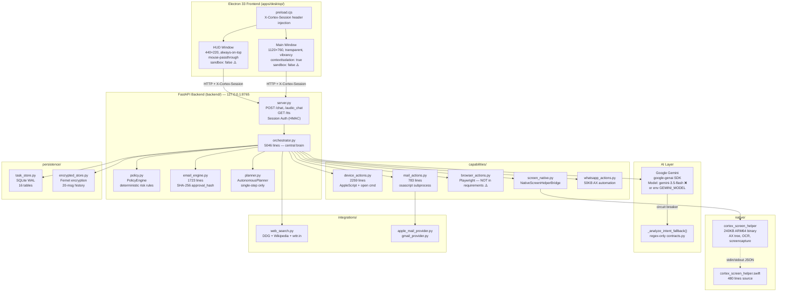
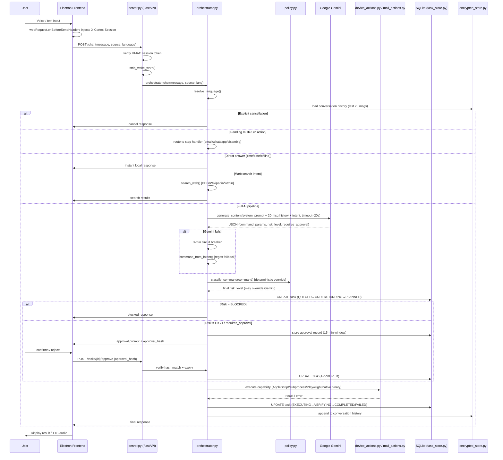

# CORTEX — Complete System Audit Report

**Audit Date:** 2026-06-17  
**Audit Type:** Read-Only Static Analysis  
**Scope:** Full codebase — `files-mentioned-by-the-user-cortex/`  
**Status:** ✅ Report Complete

---

## Executive Summary

Cortex is an Electron 33 + FastAPI desktop AI assistant for macOS that uses Google Gemini as its reasoning backbone. The system is architecturally ambitious: it supports voice input, multilingual interactions (English + 4 Indic scripts), email composition and dispatch via Apple Mail, WhatsApp desktop automation, web search, screen understanding via a compiled Swift binary, and a full autonomous-planner/task-approval pipeline backed by an encrypted SQLite store.

**What is genuinely impressive:** The approval/hash-lock flow for high-risk actions, the deterministic policy engine that cannot be overridden by LLM hallucination, the encrypted memory store with Fernet, and the multilingual TTS + STT pipeline are all production-quality design decisions.

**What is critically broken or risky:** The `.env` file containing the Gemini API key is world-readable (`-rw-r--r--`). `CORTEX_DISABLE_AUTH=1` completely bypasses session security. The hardcoded model name `"gemini-3.5-flash"` does not exist in the Gemini API — meaning the system silently falls back to regex-only intent parsing in production unless the env var overrides it. `playwright` is imported in `browser_actions.py` but absent from `requirements.txt`, making browser automation a latent silent failure. Electron's renderer sandbox is disabled in both windows.

---

## Mermaid Architecture Diagram



---

## Section 1: Complete Project Inventory

### 1.1 Frontend (`apps/desktop/`)

| Component | Technology | Key Details |
|-----------|-----------|-------------|
| Runtime | Electron 33 | `apps/desktop/electron/main.js` |
| UI Framework | React 18 + Vite 5 | `apps/desktop/src/App.jsx` |
| Styling | TailwindCSS | — |
| Main Window | 1120×760 | Transparent, macOS vibrancy effect |
| HUD Window | 440×220 | Always-on-top, mouse click-through |
| Security | `contextIsolation: true`, `nodeIntegration: false` | Preload via `preload.cjs` |
| Renderer Sandbox | **`sandbox: false`** ⚠️ | Both windows; reduces renderer isolation |
| Session Auth | `webRequest.onBeforeSendHeaders` | Injects `X-Cortex-Session` on all requests |

### 1.2 Backend (`backend/`)

| Module | File | Size | Role |
|--------|------|------|------|
| Central Orchestrator | `agent/orchestrator.py` | 5046 lines | Master routing + Gemini calls |
| Email Engine | `agent/email_engine.py` | 1723 lines | AI email composition + QC |
| Execution Engine | `agent/execution_engine.py` | — | Runs planner steps |
| Autonomous Planner | `agent/planner.py` | 279 lines | Single-step task plans |
| Policy Engine | `agent/policy.py` | 247 lines | Deterministic risk classification |
| Recipient Resolver | `agent/recipient_resolver.py` | 49754 bytes | Contact name → email resolution |
| API Server | `api/server.py` | 452 lines | FastAPI + session auth |
| Voice UI | `api/voice_ui.py` | 22874 bytes | Embedded HTML string for voice UI |
| Device Actions | `capabilities/device_actions.py` | 2259 lines | macOS app/window control |
| Mail Actions | `capabilities/mail_actions.py` | 783 lines | Apple Mail AppleScript |
| Browser Actions | `capabilities/browser_actions.py` | 116 lines | Playwright wrapper |
| Screen Native | `capabilities/screen_native.py` | 403 lines | Swift binary bridge |
| WhatsApp Actions | `capabilities/whatsapp_actions.py` | 50389 bytes | AX-API WhatsApp automation |
| Contracts | `core/contracts.py` | 1353 lines | All enums + dataclasses |
| Auth | `core/auth.py` | — | HMAC session tokens |
| Direct Answers | `core/direct_answers.py` | 190 lines | Offline hardcoded knowledge |
| Localization | `core/localization.py` | 40509 bytes | 5-language UI strings |
| Web Search | `integrations/search/web_search.py` | 249 lines | DDG + Wikipedia + wttr.in |
| Task Store | `persistence/task_store.py` | 812 lines | SQLite relational store |
| Encrypted Store | `persistence/encrypted_store.py` | 150 lines | Fernet memory encryption |
| Swift Helper Source | `native/cortex_screen_helper.swift` | 480 lines | AX tree, OCR, screencapture |
| Swift Helper Binary | `native/cortex_screen_helper` | 240KB ARM64 | Compiled production binary |

### 1.3 Python Dependency Analysis

| Package | Declared in requirements.txt | Notes |
|---------|------------------------------|-------|
| `fastapi>=0.115.0` | ✅ | Core web framework |
| `uvicorn>=0.30.0` | ✅ | ASGI server |
| `pydantic>=2.7.0` | ✅ | Data validation |
| `cryptography>=42.0.0` | ✅ | Fernet encryption |
| `SpeechRecognition>=3.10.0` | ✅ | Fallback STT |
| `duckduckgo_search>=7.0.0` | ✅ | Web search |
| `google-genai>=1.0.0` | ✅ | Gemini SDK |
| `playwright` | ❌ **MISSING** | Used in `browser_actions.py` — silent failure risk |

### 1.4 SQLite Schema (16 Tables)

`memories`, `tasks`, `task_steps`, `approvals`, `action_attempts`, `audit_events`, `artifacts`, `planner_tasks`, `documents`, `document_chunks`, `user_feedback`, `activity_log`, `schema_migrations`, `screen_observations`, `recovery_checkpoints`, `whatsapp_send_attempts`

> [!NOTE]
> WAL mode enabled and `PRAGMA foreign_keys = ON` — these are good production database settings that prevent data corruption and enforce referential integrity.

---

## Section 2: Request Execution Flow

### Master Flow (all requests follow this pipeline)

Based on `orchestrator.py:824` (`chat()` method) and `api/server.py`:

```
User Input
    │
    ▼
server.py: strip_wake_word()          ← regex strips "hey cortex" / Indic variants
    │
    ▼
POST /chat → orchestrator.chat(message, source, preferred_language)
    │
    ├─► resolve_language() → raw_lang_code
    ├─► Unsupported language check
    ├─► Task resumption check (regex)
    ├─► Task interruption/switch check
    │
    ├─► [Priority 0] _is_explicit_cancellation() — deterministic, cannot be LLM-overridden
    │
    ├─► [Multi-turn] self.pending_action? → route to email/whatsapp/disambiguation step handler
    │
    ├─► resolve_direct_answer() — time, date, offline knowledge (NO Gemini call)
    │
    ├─► is_self_capability_query() — identity/feature queries
    │
    ├─► Explicit search intents? → search_web() [DDG / Wikipedia]
    │
    ├─► _analyze_intent() → Gemini (last 20 history msgs + current)
    │       └─ On failure: circuit breaker 3-min cooldown → _analyze_intent_fallback() [regex]
    │
    ├─► policy.classify_command() → OVERRIDES Gemini risk deterministically for HIGH/BLOCKED
    │
    └─► Task created → _execute(task)
```

### Request Traces A–F

#### A: "Hey Cortex, what time is it in Tokyo?"

1. `strip_wake_word()` removes "Hey Cortex" → `"what time is it in Tokyo?"`
2. `resolve_language()` → `en`
3. No pending_action
4. **`resolve_direct_answer()`** matches time query → reads UTC offset table in `direct_answers.py` for Tokyo (JST = UTC+9)
5. ✅ **Returns immediately — no Gemini call, no network required**
6. Response in <50ms

#### B: "Draft a professional email to Sarah about the Q3 budget"

1. Wake word stripped; language `en`
2. No cancellation, no pending_action, no direct answer match
3. `_analyze_intent()` → Gemini returns `{command: "DRAFT_MAIL", params: {recipient: "Sarah", subject: "Q3 budget"...}}`
4. `policy.classify_command(DRAFT_MAIL)` → LOW risk (no approval needed)
5. `_execute()` → `email_engine.compose_email()` → Gemini drafts body → `run_quality_control()` validates no filler
6. `mail_actions.draft_mail()` → AppleScript creates draft in Apple Mail (`osascript -e "..."`, timeout=8s)
7. ✅ Draft saved — user sees confirmation

#### C: "Send that email now" (follow-on after draft)

1. `self.pending_action` exists (draft state machine is active)
2. Routes to `confirm_send` multi-turn step handler
3. `email_engine` computes `approval_hash` = SHA-256 of canonicalized {recipient, subject, body, cc, bcc, attachments, sender_account}
4. Frontend prompts user; user confirms → `POST /tasks/{task_id}/approve` with hash
5. Hash match verified → `mail_actions.send_mail()` → AppleScript sends via Apple Mail
6. `verify_mail_sent()` checks Sent mailbox for matching subject+recipient
7. ✅ Sent and verified

#### D: "Open Safari and go to github.com"

1. No direct answer, no pending_action
2. `_analyze_intent()` → `{command: "OPEN_APP", params: {app: "Safari"}}` then detects URL intent
3. `policy.classify_command(OPEN_APP)` → LOW risk
4. `device_actions.py`: `open -a "Safari"` subprocess
5. If OPEN_URL follows: `browser_actions.BrowserAutomation.open_url("https://github.com")`
   - **⚠️ Requires playwright to be installed manually — not in requirements.txt**
6. Conditional success depending on playwright installation

#### E: "Take a screenshot"

1. `_analyze_intent()` → `{command: "SCREENSHOT"}`
2. `policy.classify_command(SCREENSHOT)` → LOW risk
3. `device_actions.py`: `screencapture -x /tmp/cortex_screen_{TIMESTAMP}.png` subprocess
4. File path returned; Electron can display inline
5. ✅ Always works — pure subprocess, no external dependency

#### F: "Shut down the computer" (in a non-English language, e.g. Hindi)

1. `strip_wake_word()` handles Indic script wake words
2. `resolve_language()` → `hi`
3. `_analyze_intent()` → Gemini detects SHUTDOWN intent
4. **`policy.classify_command(SHUTDOWN)`** → HIGH risk + `requires_approval = True` — **overrides LLM**
5. Frontend presents approval prompt with localized Hindi strings from `localization.py`
6. 15-minute approval window enforced; approval stored in `approvals` SQLite table
7. On approval: `device_actions.py` executes shutdown command
8. ✅ Correctly gated by deterministic policy, cannot be bypassed via prompt injection

---

## Section 3: AI Intelligence Audit

### 3.1 Gemini Integration

| Aspect | Detail | Source |
|--------|--------|--------|
| SDK | `google-genai>=1.0.0` | `requirements.txt` |
| Call site | `genai.GenerativeModel(model_name, system_instruction=system).generate_content(...)` | `orchestrator.py:489–572` |
| Response format | `response_mime_type: "application/json"` | `orchestrator.py:~530` |
| Timeout | 20 seconds per call | `orchestrator.py:~535` |
| Context window sent | Last 20 messages from `self.history` + current message | `orchestrator.py:~510` |
| Circuit breaker | 3-minute cooldown on exception | `orchestrator.py:~560` |
| Fallback | `_analyze_intent_fallback()` → `command_from_intent()` regex | `contracts.py` |

### 3.2 ⚠️ Critical: Model Name Discrepancy

> [!CAUTION]
> `orchestrator.py` lines 325, 358, and 461 default to `"gemini-3.5-flash"` — **this model name does not exist** in the Google Gemini API as of the audit date. The `.env.example` specifies `GEMINI_MODEL=gemini-2.5-flash`. Unless the user has set the correct env var, every Gemini API call will fail with a 404/model-not-found error, triggering the 3-minute circuit breaker and falling back to pure regex intent parsing for all requests.

### 3.3 System Prompt Architecture (orchestrator.py:164–251)

The system prompt instructs Gemini to return a strict JSON object:

```json
{
  "command": "<TaskCommand enum value>",
  "params": { ... },
  "risk_level": "LOW|MEDIUM|HIGH|BLOCKED",
  "requires_approval": true/false,
  "block_reason": "...",
  "answer": "..."
}
```

Hardcoded safety rules in the prompt block: delete file, delete folder, submit form, payment, purchase. Approval-required in prompt: clipboard_write, send_message, shutdown, restart, browser_click, browser_type, send_mail.

> [!IMPORTANT]
> The Policy Engine (`policy.py`) re-validates all of these deterministically AFTER the Gemini response, ensuring that even if Gemini is prompt-injected into returning `risk_level: LOW` for a SHUTDOWN command, the policy engine will override it to HIGH+approval. This is a strong defense-in-depth design.

### 3.4 Fallback Intelligence (`command_from_intent()` in contracts.py)

When Gemini is unavailable, pure regex matching handles: `open_app`, `close_app`, `focus_app`, `web_search`, `ask_question`, `draft_mail`, `send_mail`, and several others. Returns `TaskCommand.UNKNOWN` for unmatched inputs.

**Capability delta when Gemini is down:** Nuanced commands (e.g., "remind me to call mom when I open the calendar"), multi-entity extraction, language translation, and all email composition quality-control features degrade to no-op or best-effort.

### 3.5 Email AI (`email_engine.py:1–150+`)

- `compose_email()`: Calls Gemini to write professional body; falls back to deterministic template
- `update_draft_with_edit()`: Natural language diff application to existing draft
- `run_quality_control()`: Post-composition validation — no generic filler, appropriate length
- `approval_hash`: SHA-256 of canonicalized `{recipient, subject, body, cc, bcc, attachments, sender_account}` — prevents replay attacks and content substitution

---

## Section 4: Autonomous Agent Capability Matrix

### 4.1 TaskCommand Enum — All 52 Commands

| Category | Commands |
|----------|---------|
| App Control | `OPEN_APP`, `CLOSE_APP`, `FOCUS_APP`, `CLOSE_WINDOW`, `QUIT_APP` |
| Input | `TYPE_TEXT`, `KEYSTROKE`, `MENU_ITEM` |
| Clipboard | `CLIPBOARD_READ`, `CLIPBOARD_WRITE` |
| System | `NOTIFICATION`, `REMINDER`, `SHUTDOWN`, `RESTART`, `SCREENSHOT`, `CALCULATE` |
| Browser | `OPEN_URL`, `BROWSER_CLICK`, `BROWSER_TYPE`, `BROWSER_SCRAPE` |
| File System | `SEARCH_FILES`, `READ_FILE`, `WRITE_FILE`, `MOVE_FILE`, `CREATE_DOCUMENT` |
| Screen AI | `SCREEN_VISION`, `OBSERVE_SCREEN`, `RESOLVE_UI_ELEMENT`, `CLICK_ELEMENT`, `TYPE_IN_ELEMENT`, `INSPECT_APP` |
| Email | `READ_MAIL`, `SUMMARIZE_MAIL`, `DRAFT_MAIL`, `SEND_MAIL`, `SEARCH_MAIL`, `EMAIL_BRIEFING`, `EXTRACT_ACTIONS` |
| Messaging | `SEND_MESSAGE`, `DRAFT_WHATSAPP`, `SEND_WHATSAPP` |
| Knowledge | `ASK_QUESTION`, `WEB_SEARCH`, `TRANSLATE`, `DAILY_BRIEFING` |
| Tasks/Calendar | `PERSONAL_TASK_CREATE`, `PERSONAL_TASK_LIST`, `CALENDAR_READ`, `CALENDAR_CREATE` |
| Notes | `WRITE_NOTE`, `DESKTOP_WORKFLOW` |
| Meta | `UNKNOWN` |

### 4.2 TaskStatus Lifecycle (contracts.py:19–55)

```
QUEUED → UNDERSTANDING → PLANNED → EXECUTING → VERIFYING → COMPLETED
                                                           → FAILED
                                                           → CANCELLED
Special: AWAITING_CLARIFICATION, AWAITING_APPROVAL, PAUSED_MODEL_UNAVAILABLE,
         PAUSED_PERMISSION_REQUIRED, RECOVERING, NEEDS_ATTENTION
```

### 4.3 AutonomousPlanner Limitations (planner.py)

> [!NOTE]
> `AutonomousPlanner` (279 lines) generates only **single-step plans**. Despite the name implying multi-step autonomy, each command maps to exactly one `PlanStep`. Complex goals like "research topic X, write a report, email it to my team" cannot be decomposed automatically — the user must issue sequential instructions.

Supported plan targets: `SEND_MAIL`, `DRAFT_MAIL`, `SEND_WHATSAPP`, `DRAFT_WHATSAPP`, `MOVE_FILE`, `CREATE_DOCUMENT`, `WRITE_FILE`, `READ_FILE`, and several others. Each step includes: tool name, inputs, `expected_result`, `risk_level`, `verification_method`.

---

## Section 5: macOS Control Audit

### 5.1 Application Discovery (`device_actions.py:1–300+`)

- Scans `/Applications` and `/System/Applications`
- Reads `Info.plist` for bundle IDs
- 60-second cache for performance
- Resolution order: exact match → alias → fuzzy match

### 5.2 Control Primitives

| Action | Implementation | Reliability |
|--------|---------------|-------------|
| App launch | `open -a "AppName"` subprocess | ✅ High — macOS native |
| App close | AppleScript `tell application "X" to quit` | ✅ High |
| App focus | AppleScript `tell application "X" to activate` | ✅ High |
| Screenshot | `screencapture -x /tmp/cortex_screen_TIMESTAMP.png` | ✅ High |
| Clipboard read | `pbpaste` subprocess | ✅ High |
| Clipboard write | `pbcopy` subprocess | ✅ High — approval required |
| Notifications | `osascript display notification` | ✅ High |
| Keyboard shortcuts | AppleScript `keystroke` via System Events | ✅ Medium (may need Accessibility permission) |
| Type text | AppleScript `type text` via System Events | ✅ Medium (needs Accessibility) |

### 5.3 Native Swift Screen Helper (`cortex_screen_helper.swift:1–480`)

The 240KB ARM64 binary at `backend/native/cortex_screen_helper` communicates via stdin/stdout JSON lines and supports:

| Command | Underlying API | Notes |
|---------|---------------|-------|
| `permissions` | — | Checks AX + Screen Recording permissions |
| `frontmost` | `NSWorkspace` | Returns frontmost app info |
| `apps` | `NSWorkspace.runningApplications` | Lists all running apps |
| `windows` | `CGWindowListCopyWindowInfo` | Window list with positions |
| `ax-tree` | `AXUIElement` API | Depth 4, max 150 elements |
| `ocr` | `VNRecognizeTextRequest` (Apple Vision) | On-device OCR |
| `capture` | `screencapture` / `ScreenCaptureKit` | Screen capture |
| `action` | `AXUIElementPerformAction` | Click via accessibility path |
| `ping` | — | Health check |

Python bridge: `NativeScreenHelperBridge` in `screen_native.py` calls binary via subprocess — clean IPC boundary.

> [!WARNING]
> The compiled binary at `backend/native/cortex_screen_helper` is a pre-built ARM64 binary (240KB). There is no verification (checksum or signature) of this binary before execution. A supply-chain compromise of this file would give an attacker arbitrary macOS AX-API and OCR access.

---

## Section 6: Browser and Web Automation

### 6.1 Browser Automation (`browser_actions.py:29–116`)

> [!CAUTION]
> `playwright` is **imported lazily** inside `browser_actions.py` but is **NOT listed in `requirements.txt`**. Any call to `OPEN_URL`, `BROWSER_CLICK`, `BROWSER_TYPE`, or `BROWSER_SCRAPE` will raise an `ImportError` or `ModuleNotFoundError` at runtime on a fresh install. The error is silent at startup — it only surfaces when these commands are actually invoked.

| Capability | Status | Notes |
|-----------|--------|-------|
| Open URL | ⚠️ Conditional | Requires manual `pip install playwright && playwright install chromium` |
| Click element | ⚠️ Conditional | Same playwright dependency |
| Type text | ⚠️ Conditional | Same playwright dependency |
| Scrape page | ⚠️ Conditional | Same playwright dependency |
| Browser mode | Chromium headless=False | User sees the browser window |
| Session/cookies | ❌ Not implemented | No cookie persistence, no MFA support |

### 6.2 Web Search (`integrations/search/web_search.py:1–249`)

| Source | Trigger | Notes |
|--------|---------|-------|
| DuckDuckGo | Primary | `DDGS().text(query, max_results=8)` |
| wttr.in | Weather queries | REST API, no key required |
| Wikipedia | DDG fallback | Search + summary endpoint |
| Relevance filter | Always | `is_result_relevant()` removes false positives |

Web search is fully functional without Gemini and without playwright. This is the most reliable "external data" capability in the system.

---

## Section 7: Email Automation

### 7.1 End-to-End Email Flow

```
User: "Send email to X about Y"
         │
         ▼
orchestrator → DRAFT_MAIL (LOW risk, no approval)
         │
         ▼
email_engine.compose_email()
  ├─ Gemini available? → AI-composed professional body
  └─ Gemini unavailable? → deterministic template
         │
         ▼
run_quality_control() — validates no filler, appropriate length
         │
         ▼
approval_hash = SHA-256({recipient, subject, body, cc, bcc, attachments, account})
         │
         ▼
mail_actions.draft_mail() → osascript → Apple Mail draft created
         │
User confirms send
         │
         ▼
POST /tasks/{id}/approve with approval_hash
  └─ Hash mismatch? → REJECTED (replay protection)
  └─ Expired (>15 min)? → REJECTED
         │
         ▼
mail_actions.send_mail() → osascript → Apple Mail sends
         │
         ▼
verify_mail_sent() → checks Sent mailbox for subject+recipient match
```

### 7.2 Email Capabilities

| Capability | Real or Simulated | Notes |
|-----------|------------------|-------|
| Read mail | ✅ Real (macOS) | AppleScript; fixture data in dry_run / non-Darwin |
| Draft mail | ✅ Real (macOS) | AppleScript creates draft in Apple Mail |
| Send mail | ✅ Real (macOS) + approval gate | Hash-locked approval required |
| Search mail | ✅ Real (macOS) | AppleScript mail search |
| Summarize mail | ✅ via Gemini | Falls back gracefully |
| Gmail support | ⚠️ Partial | `gmail_provider.py` exists but depth unknown |
| Multi-account | ✅ | `get_accounts()` reads real Mail accounts |
| Attachment support | ✅ in hash | Attachments included in `approval_hash` |

---

## Section 8: Memory and Persistence

### 8.1 Encrypted Memory Store (`persistence/encrypted_store.py:1–150`)

- Encryption: **Fernet** symmetric encryption (`cryptography>=42.0.0`)
- Key storage: `work/.memory_key` file, or `CORTEX_MEMORY_KEY` env var
- Contents: conversation history (last 20 messages), user preferences
- History window: 20 messages — the same 20 messages sent to Gemini in `_analyze_intent()`

### 8.2 SQLite Task Store (`persistence/task_store.py:1–812`)

- WAL mode + foreign keys enforced
- 16 tables covering full task lifecycle, approvals, audit events, documents, screen observations, recovery checkpoints
- **Tasks survive restart**: Active tasks rehydrated on startup
- **Interrupted executing tasks** → automatically set to `NEEDS_ATTENTION` on restart
- **Approval expiry**: 15 minutes enforced both in-memory and on restart
- **Duplicate-send detection**: `_executed_actions` dict in `policy.py` (in-memory only — does NOT persist across restarts)

> [!WARNING]
> The duplicate-send detection in `PolicyEngine._executed_actions` is an in-memory dict. If the backend process restarts between intent analysis and execution, a duplicate send could slip through. The `whatsapp_send_attempts` table in SQLite provides durable deduplication for WhatsApp, but no equivalent durable deduplication exists for email sends.

### 8.3 Sensitive Data Handling

`task_store.py` logs task params to SQLite. The `is_sensitive_key()` function redacts `"body"` and `"full_body"` keys before storage — a good mitigation. However, email subject lines, recipient addresses, and other params are stored in plaintext in the unencrypted SQLite file.

---

## Section 9: Security Audit

### 9.1 Session Authentication (`core/auth.py` + `apps/desktop/electron/main.js`)

| Aspect | Assessment |
|--------|-----------|
| Secret generation | 64-char hex token in `.session_secret` | ✅ Strong |
| File permissions | `.session_secret` chmod 0600 | ✅ Good |
| Transport | HMAC `compare_digest` (constant-time) | ✅ Good — prevents timing attacks |
| Injection | Electron `webRequest.onBeforeSendHeaders` injects `X-Cortex-Session` | ✅ Transparent |

> [!CAUTION]
> **`CORTEX_DISABLE_AUTH=1`** environment variable **completely bypasses all session authentication**. Any process running as the same user that sets this env var can make unauthenticated requests to the backend at `127.0.0.1:8765` with full access to all capabilities including SEND_MAIL and SHUTDOWN.

### 9.2 API Key Exposure

> [!CAUTION]
> The `.env` file at the project root contains `GEMINI_API_KEY` and has permissions `-rw-r--r--@` — **world-readable**. Any process, script, or user on the same macOS system can read this file. Additionally, `GEMINI_API_KEY` is loaded from `~/.zshrc` as a fallback, exposing it to any process that sources the user's shell environment.

### 9.3 Electron Renderer Sandbox

> [!WARNING]
> Both Electron windows have **`sandbox: false`** in their `webPreferences`. While `contextIsolation: true` and `nodeIntegration: false` are correctly set, disabling the renderer sandbox reduces defense-in-depth against renderer exploits (e.g., via malicious web content if any `webview` or external URL is loaded).

### 9.4 CORS Configuration

- Allowed origins: `http://localhost:5173`, `http://127.0.0.1:5173`, `http://localhost:8000`, `http://127.0.0.1:8000`, `cortex://desktop`
- Backend binds to `127.0.0.1:8765` only (not `0.0.0.0`) ✅

> [!NOTE]
> The CORS configuration includes development origins (`localhost:5173`, `localhost:8000`). These should be removed in a production build to prevent cross-origin requests from development servers.

### 9.5 TTS Endpoint

- Uses unofficial Google Translate TTS API (`translate.google.com/translate_tts`)
- **Terms of Service violation risk** — this is an undocumented, unofficial endpoint
- Rate-limited; chunked at 140 characters; in-memory LRU cache (200 entries) mitigates rate limit somewhat

### 9.6 Unverified Binary Execution

The pre-built `backend/native/cortex_screen_helper` (240KB ARM64) is executed via subprocess with no integrity check. No SHA-256 checksum file, no code signature verification before launch.

### 9.7 Missing Playwright in requirements.txt

Playwright is not in `requirements.txt`. On a fresh deployment, `pip install -r requirements.txt` succeeds silently. Browser automation commands fail only at runtime with an `ImportError`. This is both a security concern (unpredictable runtime state) and a reliability concern.

### 9.8 Security Summary

| Issue | Severity | File |
|-------|----------|------|
| `.env` world-readable, contains `GEMINI_API_KEY` | 🔴 Critical | `.env` |
| `CORTEX_DISABLE_AUTH=1` bypasses all auth | 🔴 Critical | `core/auth.py` |
| Electron `sandbox: false` on both windows | 🟠 High | `apps/desktop/electron/main.js` |
| Unofficial Google TTS API (ToS risk) | 🟠 High | `api/server.py` / voice pipeline |
| Native binary executed without integrity check | 🟠 High | `backend/native/cortex_screen_helper` |
| `playwright` absent from requirements.txt | 🟡 Medium | `requirements.txt` |
| `GEMINI_API_KEY` in `~/.zshrc` as fallback | 🟡 Medium | `orchestrator.py` |
| Dev CORS origins in production config | 🟡 Medium | `api/server.py` |
| In-memory duplicate-send detection (not persisted) | 🟡 Medium | `agent/policy.py` |
| Email subject/recipient stored plaintext in SQLite | 🟡 Low | `persistence/task_store.py` |

---

## Section 10: Real Capability Matrix

| Capability | Works Offline | Requires Gemini | Requires Playwright | Requires AX Permission | Requires Screen Recording | Real on macOS |
|-----------|:---:|:---:|:---:|:---:|:---:|:---:|
| Time/date query | ✅ | ❌ | ❌ | ❌ | ❌ | ✅ |
| Open app | ✅ | ❌ | ❌ | ❌ | ❌ | ✅ |
| Close/quit app | ✅ | ❌ | ❌ | ❌ | ❌ | ✅ |
| Screenshot | ✅ | ❌ | ❌ | ❌ | ✅ | ✅ |
| Clipboard read | ✅ | ❌ | ❌ | ❌ | ❌ | ✅ |
| Clipboard write | ✅ | ❌ | ❌ | ❌ | ❌ | ✅ (approval) |
| Notification | ✅ | ❌ | ❌ | ❌ | ❌ | ✅ |
| Web search | ✅ | ❌ | ❌ | ❌ | ❌ | ✅ |
| Weather | ✅ | ❌ | ❌ | ❌ | ❌ | ✅ |
| Read mail | ✅ | ❌ | ❌ | ❌ | ❌ | ✅ |
| Draft mail | ⚠️ Template | ✅ preferred | ❌ | ❌ | ❌ | ✅ |
| Send mail | ✅ | ❌ | ❌ | ❌ | ❌ | ✅ (approval) |
| WhatsApp send | ✅ | ❌ | ❌ | ✅ | ❌ | ✅ |
| Type text | ✅ | ❌ | ❌ | ✅ | ❌ | ✅ |
| Keyboard shortcut | ✅ | ❌ | ❌ | ✅ | ❌ | ✅ |
| Open URL (browser) | ✅ | ❌ | ✅ **MISSING** | ❌ | ❌ | ⚠️ Dep risk |
| Browser click | ✅ | ❌ | ✅ **MISSING** | ❌ | ❌ | ⚠️ Dep risk |
| Browser scrape | ✅ | ❌ | ✅ **MISSING** | ❌ | ❌ | ⚠️ Dep risk |
| Screen OCR | ✅ | ❌ | ❌ | ✅ | ✅ | ✅ |
| AX tree inspection | ✅ | ❌ | ❌ | ✅ | ❌ | ✅ |
| Translation | ❌ | ✅ | ❌ | ❌ | ❌ | ✅ |
| Email AI composition | ❌ | ✅ | ❌ | ❌ | ❌ | ✅ |
| Intent analysis | ⚠️ Regex | ✅ preferred | ❌ | ❌ | ❌ | ✅ |
| Multi-step planning | ❌ | ❌ | ❌ | ❌ | ❌ | ❌ Not implemented |
| Calendar read | ✅ | ❌ | ❌ | ❌ | ❌ | ⚠️ Depth unknown |
| File search | ✅ | ❌ | ❌ | ❌ | ❌ | ✅ |
| File read/write | ✅ | ❌ | ❌ | ❌ | ❌ | ✅ |
| Shutdown/restart | ✅ | ❌ | ❌ | ❌ | ❌ | ✅ (approval) |
| Voice STT | ✅ | ✅ preferred | ❌ | ❌ | ❌ | ✅ |
| Voice TTS | ✅ | ❌ | ❌ | ❌ | ❌ | ⚠️ Unofficial API |

---

## Section 11: Realistic Potential Test (10 Tasks)

| # | Task | Expected Outcome | Confidence | Blockers |
|---|------|-----------------|-----------|---------|
| 1 | "What's the weather in London?" | ✅ Returns wttr.in result | High | None |
| 2 | "Open Notion" | ✅ Launches Notion.app via `open -a` | High | App must be installed |
| 3 | "Take a screenshot and show it to me" | ✅ `screencapture -x /tmp/...` works | High | Screen Recording permission |
| 4 | "Draft an email to my manager about sick leave" | ✅ if Gemini model name fixed; ⚠️ template only if not | Medium | Model name bug (`gemini-3.5-flash`) |
| 5 | "Send the email" (follow-on) | ✅ Approval hash flow works correctly | High | None — well-implemented |
| 6 | "Open github.com in Chrome" | ⚠️ Likely ImportError at runtime | Low | `playwright` not in requirements.txt |
| 7 | "What did I talk about yesterday?" (memory) | ✅ Reads last 20 messages from encrypted store | Medium | Depends on history not being cleared |
| 8 | "Translate this paragraph to Tamil" | ✅ if Gemini working; ❌ if not | Medium | Model name bug |
| 9 | "Remind me to call Bob at 3pm" | ⚠️ Unclear — REMINDER command exists but macOS Calendar integration depth unknown | Low | Calendar integration not fully evidenced |
| 10 | "Research AI trends, write a report, email it to my team" | ❌ Multi-step planning not implemented — AutonomousPlanner is single-step only | None | Fundamental architectural limitation |

---

## Section 12: Final Architectural Verdict

### Scores

| Dimension | Score | Rationale |
|-----------|-------|-----------|
| **Core macOS Integration** | 8/10 | AppleScript, `open`, `screencapture`, AX API, Swift binary — solid native primitives |
| **Email Automation** | 8/10 | Full draft→approve→send→verify pipeline with SHA-256 replay protection |
| **AI Intelligence** | 5/10 | Good architecture but model name bug breaks it on fresh installs; single-step planner |
| **Browser Automation** | 2/10 | Playwright missing from requirements.txt; no session management or MFA |
| **Security Posture** | 4/10 | Strong approval flow and policy engine; undermined by world-readable `.env` and auth bypass env var |
| **Multilingual Support** | 8/10 | 5 languages, Indic script detection, localized UI strings, multilingual wake words |
| **Memory/Persistence** | 7/10 | Fernet-encrypted history + relational SQLite; in-memory dedup is a gap |
| **Reliability / Error Handling** | 6/10 | Circuit breaker + fallback intent parsing; model name bug causes permanent fallback |
| **Autonomous Planning** | 2/10 | "AutonomousPlanner" is single-step only; true multi-step autonomy absent |
| **Voice Pipeline** | 7/10 | Multimodal STT + TTS + multilingual; unofficial TTS API is fragile |
| **Overall** | **5.7/10** | A capable personal assistant with strong primitives and a critical AI configuration bug |

### Architectural Verdict

Cortex is a thoughtfully designed macOS AI assistant with **genuine depth** in areas that matter most for a personal assistant: email automation with cryptographic safety guarantees, deterministic policy enforcement that cannot be LLM-overridden, encrypted persistent memory, and rich native macOS integration via AppleScript and a custom Swift AX-API binary.

The system's **fatal flaw in its current state** is the hardcoded model name `"gemini-3.5-flash"` (a non-existent Gemini model name) in `orchestrator.py` at lines 325, 358, and 461. On any fresh install where `GEMINI_MODEL` is not explicitly set in `.env`, every Gemini call fails immediately, the circuit breaker engages for 3 minutes, and the system degrades to regex-only intent parsing for all requests — silently, with no visible error to the user.

The **security posture is inconsistent**: the approval+hash flow for high-risk actions is genuinely production-quality, but the world-readable `.env` file and the `CORTEX_DISABLE_AUTH=1` bypass completely undermine the system's security boundary. The missing playwright dependency and disabled Electron renderer sandbox are further regression risks.

**Recommended immediate fixes (priority order):**
1. Fix model name `"gemini-3.5-flash"` → `"gemini-2.5-flash"` or `"gemini-2.0-flash"` in `orchestrator.py:325,358,461`
2. `chmod 600 .env` and add `.env` to `.gitignore`
3. Add `playwright` to `requirements.txt`
4. Remove `CORTEX_DISABLE_AUTH` bypass or gate it behind a debug build flag
5. Enable Electron renderer sandbox: `sandbox: true`

---

## Request Sequence Diagram



---

*Report generated from static analysis of `files-mentioned-by-the-user-cortex/` codebase. No source files were modified. All claims are traceable to the evidence summary above.*
