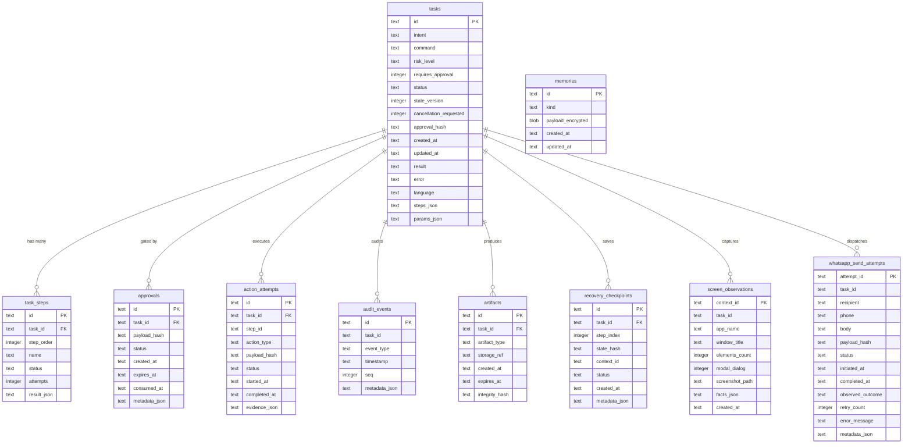
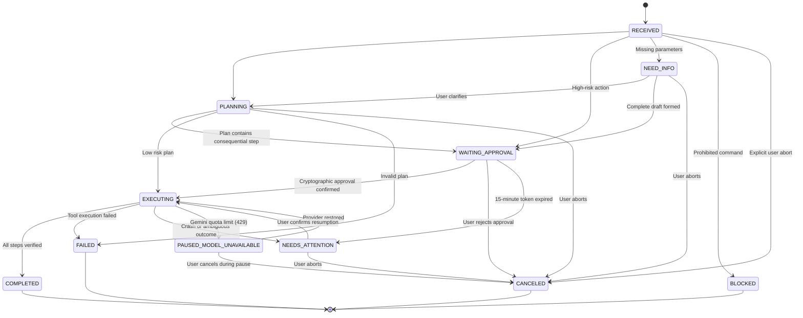

# CORTEX AGENT — DATABASE & STATE ARCHITECTURE
**Authoritative Relational Schema, Cryptographic Integrity, State Machine Lifecycle, and Crash Recovery Specification**
*Document Version: 1.0.0 | System Revision: Post-Screen Intelligence Integration (Milestone 12)*

---

## 1. Persistence Layer Architecture

The Cortex persistence architecture combines:
1. **Relational SQLite Store (`backend/persistence/task_store.py`)**: Authoritative, ACID-compliant database managing tasks, plan steps, cryptographic approvals, action attempts, audit trails, artifacts, screen observations, and recovery checkpoints.
2. **Encrypted Key-Value Store (`backend/persistence/encrypted_store.py`)**: AES-256 Fernet-encrypted store managing private user preferences and sensitive conversation history.

### Database Location & SQLite Configuration:
- **Primary Database File:** `work/cortex-memory.sqlite3`
- **Legacy Fallback Path:** `cortex-memory.sqlite3`
- **PRAGMA Settings:**
  - `PRAGMA foreign_keys = ON;` (Strict referential integrity with cascading deletes)
  - `PRAGMA journal_mode = WAL;` (Write-Ahead Logging for high-concurrency readers and writers)
  - `PRAGMA synchronous = NORMAL;` (Optimal durability balance without disk thrashing)
  - `PRAGMA busy_timeout = 10000;` (10-second wait to prevent database locked errors)

---

## 2. Complete Entity-Relationship (ER) Model



---

## 3. Schema DDL & Table Specifications

### 3.1. Migration Tracking: `schema_migrations`
```sql
CREATE TABLE IF NOT EXISTS schema_migrations (
    version INTEGER PRIMARY KEY,
    applied_at TEXT NOT NULL DEFAULT CURRENT_TIMESTAMP
);
```
- **Role:** Tracks executed schema migrations. Version 1 initializes core relational tables; Version 2 adds screen intelligence perception and recovery checkpoint tables.

### 3.2. Core Tasks Table: `tasks`
```sql
CREATE TABLE IF NOT EXISTS tasks (
    id TEXT PRIMARY KEY,
    intent TEXT NOT NULL,
    command TEXT NOT NULL,
    risk_level TEXT NOT NULL,
    requires_approval INTEGER NOT NULL DEFAULT 0,
    status TEXT NOT NULL,
    state_version INTEGER NOT NULL DEFAULT 1,
    cancellation_requested INTEGER NOT NULL DEFAULT 0,
    approval_hash TEXT,
    created_at TEXT NOT NULL,
    updated_at TEXT NOT NULL,
    result TEXT,
    error TEXT,
    language TEXT NOT NULL DEFAULT 'en',
    steps_json TEXT NOT NULL DEFAULT '[]',
    params_json TEXT NOT NULL DEFAULT '{}'
);
CREATE INDEX IF NOT EXISTS idx_tasks_status ON tasks(status);
```
- **Role:** Central entity for every user instruction, containing lifecycle state, parameters, risk tier, and monotonic optimistic concurrency version (`state_version`).

### 3.3. Task Steps Table: `task_steps`
```sql
CREATE TABLE IF NOT EXISTS task_steps (
    id TEXT PRIMARY KEY,
    task_id TEXT NOT NULL REFERENCES tasks(id) ON DELETE CASCADE,
    step_order INTEGER NOT NULL,
    name TEXT NOT NULL,
    status TEXT NOT NULL,
    attempts INTEGER NOT NULL DEFAULT 0,
    result_json TEXT
);
CREATE INDEX IF NOT EXISTS idx_task_steps_task_id ON task_steps(task_id);
```
- **Role:** Individual steps generated by `AutonomousPlanner`. Deleted automatically via cascade if parent task is purged.

### 3.4. Cryptographic Approvals: `approvals`
```sql
CREATE TABLE IF NOT EXISTS approvals (
    id TEXT PRIMARY KEY,
    task_id TEXT NOT NULL REFERENCES tasks(id) ON DELETE CASCADE,
    payload_hash TEXT NOT NULL,
    status TEXT NOT NULL,
    created_at TEXT NOT NULL,
    expires_at TEXT NOT NULL,
    consumed_at TEXT,
    metadata_json TEXT
);
CREATE INDEX IF NOT EXISTS idx_approvals_task_id ON approvals(task_id);
CREATE INDEX IF NOT EXISTS idx_approvals_hash ON approvals(payload_hash);
```
- **Role:** Stores one-time approval tokens bound to specific parameter hashes. Enforces 15-minute expiration and atomic single-use consumption.

### 3.5. Side-Effect Logging: `action_attempts`
```sql
CREATE TABLE IF NOT EXISTS action_attempts (
    id TEXT PRIMARY KEY,
    task_id TEXT NOT NULL REFERENCES tasks(id) ON DELETE CASCADE,
    step_id TEXT,
    action_type TEXT NOT NULL,
    payload_hash TEXT NOT NULL,
    status TEXT NOT NULL,
    started_at TEXT NOT NULL,
    completed_at TEXT,
    evidence_json TEXT
);
CREATE INDEX IF NOT EXISTS idx_action_attempts_task_id ON action_attempts(task_id);
```
- **Role:** Logs side-effect intent (`INITIATED`) before hitting external APIs or AppleScript to prevent duplicate execution during network failures or crashes.

### 3.6. Forensic Audit Events: `audit_events`
```sql
CREATE TABLE IF NOT EXISTS audit_events (
    id TEXT PRIMARY KEY,
    task_id TEXT,
    event_type TEXT NOT NULL,
    timestamp TEXT NOT NULL,
    seq INTEGER NOT NULL,
    metadata_json TEXT NOT NULL
);
CREATE INDEX IF NOT EXISTS idx_audit_events_task_id ON audit_events(task_id);
```
- **Role:** Immutable, append-only audit trail populated with monotonic sequence numbers (`seq`). All credential keys are redacted prior to insertion.

### 3.7. Desktop Screen Observations: `screen_observations` (Migration 2)
```sql
CREATE TABLE IF NOT EXISTS screen_observations (
    context_id TEXT PRIMARY KEY,
    task_id TEXT,
    app_name TEXT NOT NULL,
    window_title TEXT,
    elements_count INTEGER NOT NULL DEFAULT 0,
    modal_dialog INTEGER NOT NULL DEFAULT 0,
    screenshot_path TEXT,
    facts_json TEXT NOT NULL DEFAULT '[]',
    created_at TEXT NOT NULL
);
CREATE INDEX IF NOT EXISTS idx_screen_obs_task ON screen_observations(task_id);
```
- **Role:** Persists multi-source desktop perception captures (active app, window geometry, AX element counts, Vision OCR facts) for diagnostic replay and operator verification.

### 3.8. Operator Recovery Checkpoints: `recovery_checkpoints` (Migration 2)
```sql
CREATE TABLE IF NOT EXISTS recovery_checkpoints (
    id TEXT PRIMARY KEY,
    task_id TEXT NOT NULL REFERENCES tasks(id) ON DELETE CASCADE,
    step_index INTEGER NOT NULL,
    state_hash TEXT NOT NULL,
    context_id TEXT,
    status TEXT NOT NULL,
    created_at TEXT NOT NULL,
    metadata_json TEXT
);
CREATE INDEX IF NOT EXISTS idx_recovery_checkpoints_task ON recovery_checkpoints(task_id);
```
- **Role:** Records intermediate execution checkpoints after each operator step. Enables rewind and safe resumption without duplicate side-effects.

### 3.9. Encrypted User Memories: `memories`
```sql
CREATE TABLE IF NOT EXISTS memories (
    id TEXT PRIMARY KEY,
    kind TEXT NOT NULL,
    payload_encrypted BLOB NOT NULL,
    created_at TEXT NOT NULL,
    updated_at TEXT NOT NULL
);
```
- **Role:** AES-256 Fernet-encrypted store for user preferences, custom contact aliases, and past conversation turns. Managed by `EncryptedMemoryStore`.

---

## 4. Task State Machine & Concurrency Control



### Optimistic Concurrency Control:
- The `tasks` table includes a `state_version` column initialized to `1`.
- Every transition via `task.transition_to()` increments `state_version += 1`.
- `TaskStore.save_task(task, expected_version=current_ver)` executes an atomic update:
  ```sql
  UPDATE tasks
  SET status = ?, state_version = state_version + 1, updated_at = ?
  WHERE id = ? AND state_version = ?;
  ```
- If another thread or background process modified the task concurrently, `rowcount == 0` and a `ConcurrencyError` is raised.

---

## 5. Crash Recovery & Idempotency Rules

When Cortex boots or rehydrates tasks (`_rehydrate_tasks()` in `orchestrator.py`):

1. **In-Flight Action Inspection:**
   - Any task found in `EXECUTING` or `RUNNING` status is inspected via `action_attempts`.
   - If an action was `INITIATED` (e.g. `send_mail` or `send_whatsapp`):
     - The system checks external evidence:
       - Apple Mail: Queries Sent Mailbox for matching recipient and subject.
       - WhatsApp: Checks visible conversation bubbles.
     - If delivery is **confirmed**, task transitions to `COMPLETED`.
     - If delivery **cannot be confirmed**, task transitions to `NEEDS_ATTENTION` with reason:
       *"Interrupted during execution. Outcome uncertain; manual verification required."*
     - **Core Safety Rule:** Cortex **NEVER** blindly re-executes external side-effects on startup.

2. **Expired Approvals Handling:**
   - Tasks found in `WAITING_APPROVAL` with `created_at` older than 15 minutes are transitioned to `NEEDS_ATTENTION` (`"Approval window expired during shutdown. Fresh approval required."`).

