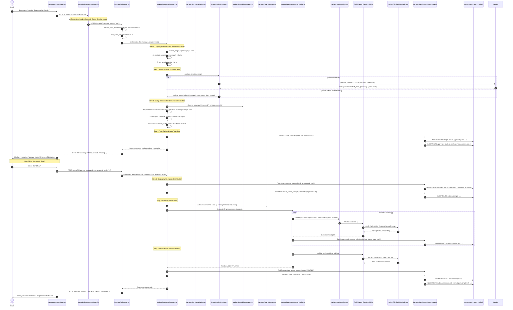

# CORTEX AGENT — COMPLETE EXECUTION FLOW TRACE
**Comprehensive Source-Code-Grounded Request Lifecycle and Startup Diagnostics**
*Document Version: 1.0.0 | System Revision: Post-Screen Intelligence Integration (Milestone 12)*

---

## 1. System Startup and Initialization Sequence

The Cortex startup sequence orchestrates three distinct processes: the compiled native Swift helper, the Python FastAPI backend, and the Electron/Vite desktop application.

```mermaid
sequenceDiagram
    autonumber
    participant Boot as start-cortex.sh
    participant FastAPIServer as backend/api/server.py
    participant TaskStore as backend/persistence/task_store.py
    participant SQLite as work/cortex-memory.sqlite3
    participant Orchestrator as backend/agent/orchestrator.py
    participant GeminiSDK as google.generativeai
    participant ElectronMain as apps/desktop/electron/main.js
    participant ReactUI as apps/desktop/src/App.jsx

    Note over Boot: 1. Shell Bootstrapping
    Boot->>FastAPIServer: uvicorn server:app --port 8765
    activate FastAPIServer

    Note over FastAPIServer: 2. Python Backend Initialization
    FastAPIServer->>FastAPIServer: Prepend backend/core/bin (FLAC wrapper) to PATH
    FastAPIServer->>FastAPIServer: Configure CORSMiddleware (localhost:5173, cortex://desktop)
    FastAPIServer->>FastAPIServer: Register session_auth_middleware

    FastAPIServer->>Orchestrator: CortexOrchestrator()
    activate Orchestrator
    
    Orchestrator->>TaskStore: TaskStore("work/cortex-memory.sqlite3")
    activate TaskStore
    TaskStore->>SQLite: PRAGMA foreign_keys = ON; PRAGMA journal_mode = WAL;
    TaskStore->>SQLite: Run Migrations 1 & 2 (tasks, steps, approvals, screen_observations)
    deactivate TaskStore

    Orchestrator->>Orchestrator: Initialize Subsystems (PolicyEngine, ToolRegistry, Planner, ExecutionEngine)
    Orchestrator->>GeminiSDK: genai.configure(api_key) [if GEMINI_API_KEY present]
    Orchestrator->>TaskStore: _rehydrate_tasks() (Scan & reconcile active tasks)
    deactivate Orchestrator

    Note over Boot: 3. Electron App Launch
    Boot->>ElectronMain: electron .
    activate ElectronMain
    ElectronMain->>ElectronMain: setupPermissions() (Request macOS microphone access)
    ElectronMain->>ElectronMain: Read .session_secret
    ElectronMain->>ElectronMain: Attach webRequest.onBeforeSendHeaders (Inject X-Cortex-Session)
    ElectronMain->>ElectronMain: Register Global Shortcuts (Alt+Space, Cmd+K)
    ElectronMain->>ReactUI: loadURL("http://127.0.0.1:5173")
    activate ReactUI
    ReactUI->>FastAPIServer: GET /health (Verify backend readiness)
    FastAPIServer-->>ReactUI: {"ok": true, "service": "cortex-cloud-brain"}
    deactivate ReactUI
    deactivate ElectronMain
    deactivate FastAPIServer
```

### Startup Component Details:

1. **`start-cortex.sh`**:
   - Launches Python virtualenv, starts FastAPI server via Uvicorn on loopback port 8765, waits for `/health` endpoint to return HTTP 200, then starts the Vite dev server and launches Electron.

2. **`backend/api/server.py`**:
   - Lines 14–22: Prepend native ARM64 `flac` binary directory (`backend/core/bin`) to `os.environ["PATH"]`.
   - Lines 48–60: Initialize `FastAPI(title="Cortex Cloud Brain", version="0.2.0")` with `ALLOWED_ORIGINS` (`localhost:5173`, `127.0.0.1:5173`, `localhost:8000`, `cortex://desktop`).
   - Lines 62–85: `session_auth_middleware` intercepts all non-exempt requests, verifying the `X-Cortex-Session` header matches `.session_secret` using `verify_session_token()`.
   - Line 87: Instantiates singleton `orchestrator = CortexOrchestrator()`.

3. **`backend/persistence/task_store.py` (`TaskStore.__init__`)**:
   - Connects to `work/cortex-memory.sqlite3`.
   - Executes `PRAGMA foreign_keys = ON;`, `PRAGMA journal_mode = WAL;`, `PRAGMA synchronous = NORMAL;`.
   - Inspects `schema_migrations`. Applies Migration 1 (`tasks`, `task_steps`, `approvals`, `action_attempts`, `audit_events`, `artifacts`) and Migration 2 (`screen_observations`, `recovery_checkpoints`, `whatsapp_send_attempts`).

4. **`backend/agent/orchestrator.py` (`CortexOrchestrator.__init__`)**:
   - Instantiates `DeviceAutomation`, `EncryptedMemoryStore`, `PolicyEngine`, `ToolRegistry`, `ExecutionEngine`, `AutonomousPlanner`, `ProfessionalEmailEngine`, and `RecipientResolver`.
   - Reads `.env` and `~/.zshrc` to discover `GEMINI_API_KEY`. If found, configures `google.generativeai`.
   - Runs `_rehydrate_tasks()`: Reads all non-terminal tasks (`WAITING_APPROVAL`, `EXECUTING`, `AWAITING_CLARIFICATION`) from SQLite. Validates approval expiration (15-minute window) and checks external side-effects (e.g. checking the Apple Mail Sent mailbox) before blind resumption.

5. **`apps/desktop/electron/main.js`**:
   - Runs `app.whenReady()`.
   - Calls `setupPermissions()` to request macOS microphone access via `systemPreferences.askForMediaAccess("microphone")`.
   - Reads `.session_secret` from the project root.
   - Configures `session.defaultSession.webRequest.onBeforeSendHeaders` to inject `X-Cortex-Session: <secret>` on all outgoing HTTP requests destined for `http://127.0.0.1:8765/*`.
   - Creates `MainWindow` (frameless vibrancy window) and `HudWindow` (always-on-top heads-up display pill).
   - Registers global shortcuts `CommandOrControl+K` (palette) and `Alt+Space` (quick summon/hide).

---

## 2. End-to-End User Request Execution Flow

Below is the exhaustive trace of a user request through every architectural layer:



---

## 3. Step-by-Step Function and Class Reference

| Stage | Component | Source File | Function / Method Name | Role |
| :--- | :--- | :--- | :--- | :--- |
| **1. User Input** | React UI | `apps/desktop/src/App.jsx` | `handleSubmit(e)` / `toggleRecording()` | Captures user keyboard submission or raw microphone WAV audio |
| **2. Transport** | Electron Main | `apps/desktop/electron/main.js` | `onBeforeSendHeaders` | Attaches `X-Cortex-Session` header transparently |
| **3. API Ingestion** | FastAPI Server | `backend/api/server.py` | `post_chat()` / `post_audio_chat()` | Validates session token, strips wake word, dispatches to orchestrator |
| **4. Speech to Text**| Voice Transcriber | `backend/voice/transcription.py` | `VoiceTranscriber.transcribe()` | Multilingual Gemini STT with Google Speech Recognition fallback |
| **5. Localization** | Language Detector| `backend/core/localization.py` | `resolve_language()` | Detects Kannada, Hindi, Tamil, Telugu, or English |
| **6. Cancellation** | Orchestrator | `backend/agent/orchestrator.py` | `_is_explicit_cancellation()` | Deterministic interrupt handler (runs before intent classification) |
| **7. Multi-Turn** | Orchestrator | `backend/agent/orchestrator.py` | `chat()` (Pending action blocks) | Handles clarification, recipient disambiguation, draft revisions |
| **8. Intent Router** | Intent Classifier | `backend/agent/orchestrator.py` | `_analyze_intent()` / `_analyze_intent_fallback()` | Extracts `TaskCommand`, parameter dict, and requested tone |
| **9. Safety Gate** | Safety Module | `backend/capabilities/safety.py` | `classify_command()` | Evaluates risk policy (`LOW`, `MEDIUM`, `HIGH`, `BLOCKED`) |
| **10. Recipient** | Recipient Resolver| `backend/agent/recipient_resolver.py` | `RecipientResolver.resolve()` | Privacy-preserving contact resolution (avoids fake synthetic matches) |
| **11. Draft Prep** | Email Engine | `backend/agent/email_engine.py` | `ProfessionalEmailEngine.compose_email()` | Generates email draft, performs QC checks, computes SHA-256 hash |
| **12. Approval** | Orchestrator | `backend/agent/orchestrator.py` | `approve()` | Validates cryptographic hash, checks 15m expiration, prevents replay |
| **13. Planning** | Autonomous Planner| `backend/agent/planner.py` | `AutonomousPlanner.plan()` | Decomposes task into atomic, verifiable `PlanStep` sequence |
| **14. Execution** | Execution Engine | `backend/agent/execution_engine.py`| `ExecutionEngine.execute_plan()` | Sequential `execute -> observe -> verify -> recover` execution loop |
| **15. Dispatch** | Tool Registry | `backend/tools/registry.py` | `ToolRegistry.execute()` | Routes step to concrete tool (`DesktopTool`, `MailTool`, `BrowserTool`) |
| **16. Native Action**| Screen Engine | `backend/capabilities/screen_native.py`| `ScreenNativeHelperBridge.dispatch()` | Dispatches JSON command to native `cortex_screen_helper` Swift binary |
| **17. State Save** | Task Store | `backend/persistence/task_store.py` | `TaskStore.save_task()` | Optimistic versioned commit to `tasks` table with WAL journaling |
| **18. Audit Log** | Task Store | `backend/persistence/task_store.py` | `TaskStore.record_audit_event()` | Writes sanitized audit trail entry to `audit_events` table |

---

## 4. Confirmed Call Paths vs. Inferred/Theoretical Fallbacks

To ensure absolute audit integrity, the table below documents which execution paths are empirically proven by automated unit/integration tests and which are fallback logic paths:

| Path | Status | Verification Evidence | Notes |
| :--- | :--- | :--- | :--- |
| **Text Chat -> Direct Answer** | Confirmed | `test_direct_answers.py` | Fast deterministic answers (clock, math) execute entirely locally. |
| **Voice Audio -> Transcribe -> Chat** | Confirmed | `test_siri_voice_and_transcription.py` | WAV audio successfully parsed by `VoiceTranscriber` with mock STT. |
| **Email Compose -> Apple Mail Draft** | Confirmed | `test_phase2_email_automation.py` | Successfully creates real draft in macOS Apple Mail via AppleScript. |
| **Email Send -> WAITING_APPROVAL Gate**| Confirmed | `test_intelligent_email_agent.py` | Strictly halted in `WAITING_APPROVAL`; never sends without explicit approval. |
| **Approval Replay Rejection** | Confirmed | `test_intelligent_email_agent.py` | Attempting to consume an already-used approval hash raises replay error. |
| **Screen Perception via Swift Helper** | Confirmed | `test_screen_intelligence_engine.py` | Native binary `cortex_screen_helper` returns live window list and AX tree. |
| **Apple Vision Framework OCR** | Confirmed | `test_screen_intelligence_engine.py` | Native Swift helper performs text extraction via `VNRecognizeTextRequest`. |
| **Multilingual Response Generation** | Confirmed | `test_phase3_multilingual.py` | Localized strings returned in native scripts (Kannada, Hindi, Tamil, Telugu). |
| **WhatsApp Direct Sending** | Hermetic Mock | `test_personal_whatsapp_visible_ui.py` | UI automation and AX observation are mocked in CI to prevent live message transmission. |
| **Gmail OAuth Provider** | Inferred Fallback| `test_email_providers_and_spec_hardening.py` | Mock tests pass; live OAuth requires user GCP Client ID credentials. |
| **Browser Puppeteer/Playwright** | Inferred Fallback| `test_phase4.py` | Headless navigation logic present; requires external Chrome instance. |

