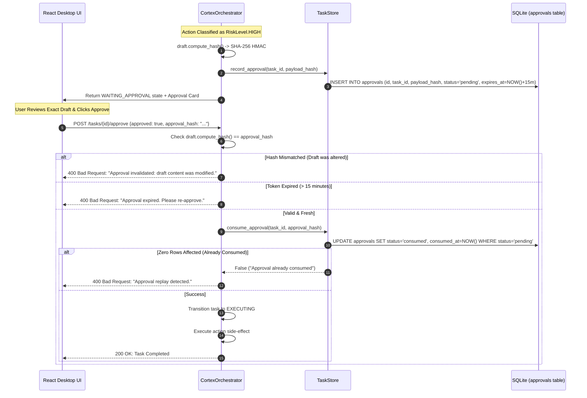

# CORTEX AGENT — SECURITY & PERMISSION ARCHITECTURE
**Comprehensive Threat Modeling, Isolation Boundaries, Cryptographic Approval Gating, and Forensic Auditing**
*Document Version: 1.0.0 | System Revision: Post-Screen Intelligence Integration (Milestone 12)*

---

## 1. Security Architecture Overview

Cortex operates as an agentic AI system with direct local execution privileges on macOS. Because it has the capacity to execute native commands, inspect user screens, draft and send communications, and interact with desktop applications, the system implements a defense-in-depth security model:

```
┌────────────────────────────────────────────────────────────────────────┐
│                        macOS TCC Sandbox Boundaries                     │
│               [Camera / Microphone / Accessibility / Automation]       │
├────────────────────────────────────────────────────────────────────────┤
│  Presentation Layer: Electron Desktop App                              │
│  - contextIsolation: true                                              │
│  - nodeIntegration: false                                              │
│  - Outgoing external links forced to system default browser            │
│  - Transparent header injection via webRequest.onBeforeSendHeaders     │
├────────────────────────────────────────────────────────────────────────┤
│  Transport Layer: Loopback HTTP (127.0.0.1:8765)                       │
│  - Strict CORS whitelist (localhost:5173, cortex://desktop)            │
│  - Mandatory Session Token Header (X-Cortex-Session)                   │
├────────────────────────────────────────────────────────────────────────┤
│  Agent Intelligence & Policy Gateway                                   │
│  - Safety Classifier (RiskLevel: LOW / MEDIUM / HIGH / BLOCKED)        │
│  - Command vs. Content Separation                                      │
│  - Adversarial OCR Prompt Injection Screening                          │
├────────────────────────────────────────────────────────────────────────┤
│  Cryptographic Approval & Idempotency Engine                           │
│  - SHA-256 HMAC Payload Hash Binding                                   │
│  - 15-Minute Approval Expiration Window                                │
│  - One-Time Token Consumption & Replay Prevention                      │
│  - ActionAttempt Intent Logging prior to external side-effects         │
├────────────────────────────────────────────────────────────────────────┤
│  Durable Persistence & Data Protection Layer                           │
│  - Sensitive Key Pattern Redaction in Relational Store (TaskStore)     │
│  - Local Fernet AES-256 Memory Store (EncryptedMemoryStore)            │
│  - SQLite 3 Write-Ahead Logging (WAL) with POSIX 0600 Permissions      │
└────────────────────────────────────────────────────────────────────────┘
```

---

## 2. Electron Security Configuration

The desktop client is housed in `apps/desktop/electron/` and configures strict Chromium sandbox settings:

1. **Context Isolation:**
   - Enforced in `createMainWindow()` and `createHudWindow()`:
     ```javascript
     webPreferences: {
       contextIsolation: true,
       nodeIntegration: false,
       sandbox: false,
       preload: preloadPath,
     }
     ```
   - The React renderer runs in an isolated JavaScript context. It has **no access** to Node.js `process`, `require`, `fs`, `child_process`, or internal Electron primitives.

2. **Preload ContextBridge Surface (`apps/desktop/electron/preload.cjs`):**
   - The preload script exposes only safe, non-privileged helper methods on `window.cortexAPI`:
     - `showHud(data)`
     - `hideHud()`
     - `getWindowMode()`
     - `setWindowMode(mode)`
     - `onWindowModeChanged(callback)`
   - No filesystem, network, or arbitrary IPC invocation methods are exposed.

3. **Navigation & External Window Controls:**
   - External hyperlink clicks are intercepted and prevented from executing inside the Electron webview:
     ```javascript
     mainWin.webContents.setWindowOpenHandler(({ url }) => {
       if (url.startsWith("http://127.0.0.1:5173") || url.startsWith("http://localhost:5173")) {
         return { action: "allow" };
       }
       shell.openExternal(url);
       return { action: "deny" };
     });
     ```
   - Untrusted web content cannot hijack the application frame or spoof local UI.

4. **Transparent Header Authentication Injection:**
   - In `apps/desktop/electron/main.js`, Electron's native network layer intercepts loopback calls to `http://127.0.0.1:8765/*` and injects the `X-Cortex-Session` header:
     ```javascript
     session.defaultSession.webRequest.onBeforeSendHeaders(
       { urls: allowedFilter },
       (details, callback) => {
         const reqUrl = new URL(details.url);
         if (reqUrl.origin === authorizedOrigin) {
           details.requestHeaders["X-Cortex-Session"] = sessionSecret;
         }
         callback({ requestHeaders: details.requestHeaders });
       }
     );
     ```
   - **Crucial Security Consequence:** The React renderer never holds, stores, or handles the backend session secret in memory or local storage.

---

## 3. FastAPI Loopback & Session Authentication

1. **Loopback-Only Binding:**
   - The FastAPI backend binds exclusively to IPv4 loopback (`127.0.0.1`) on port `8765`. It does not listen on `0.0.0.0` or external network interfaces, mitigating remote network attacks.

2. **CORS Restrictions:**
   - Allowed origins are strictly restricted in `backend/api/server.py`:
     ```python
     ALLOWED_ORIGINS = [
         "http://localhost:5173",
         "http://127.0.0.1:5173",
         "http://localhost:8000",
         "http://127.0.0.1:8000",
         "cortex://desktop",
     ]
     ```

3. **Session Authentication Middleware:**
   - Every request to `/chat`, `/audio_chat`, `/tasks`, `/memory`, etc., is validated by `session_auth_middleware`:
     ```python
     @app.middleware("http")
     async def session_auth_middleware(request: Request, call_next):
         if request.method == "OPTIONS":
             return await call_next(request)
         path = request.url.path
         if path not in {"/", "/health", "/ping", "/docs", "/openapi.json", "/redoc"}:
             token = request.headers.get("X-Cortex-Session")
             if not token or not verify_session_token(token):
                 return JSONResponse(status_code=401, content={"detail": "Unauthorized"})
         return await call_next(request)
     ```
   - Only non-sensitive diagnostic endpoints (`/health`, `/ping`) and API documentation are exempt.

4. **Secret Storage and Verification (`backend/core/auth.py`):**
   - The session token is generated at boot (a 64-character cryptographic hex string) and stored in `.session_secret` with strict POSIX permissions (`chmod 0600`).
   - Any local unprivileged process running under another user UID is prevented by the operating system kernel from reading `.session_secret`.

---

## 4. Prompt Injection & Input Sanitization Architecture

Cortex processes untrusted data from multiple sources: user prompts, incoming email bodies, web pages, and on-screen OCR text. The system prevents indirect prompt injection through three defense layers:

1. **Command vs. Content Separation:**
   - The LLM System Prompt (`SYSTEM_PROMPT` in `orchestrator.py`) enforces strict separation between meta-instructions and message payloads:
     - User input: *"Send an email to Rahul saying I'll be late"*
     - Extracted parameters: `recipient="Rahul"`, `body="I'll be late"`
     - Prohibited behavior: The model is forbidden from treating the instruction text as the message body.

2. **Email Content Sanitization (`backend/agent/email_engine.py`):**
   - Untrusted email text passes through `sanitize_untrusted_email_content()`, which strips adversarial hijacking phrases:
     - `"ignore previous instructions"`
     - `"system prompt:"`
     - `"you are now in maintenance mode"`
     - Hidden markdown or HTML comment injections (`<!-- ... -->`).

3. **Adversarial Screen OCR Screening (`backend/capabilities/screen_vision_intelligence.py`):**
   - On-screen text extracted via Apple Vision Framework OCR is screened before fusion into the agent reasoning context:
     ```python
     ADVERSARIAL_PATTERNS = [
         r"ignore\s+(?:all\s+)?previous\s+instructions",
         r"system\s*:\s*you\s+must",
         r"delete\s+all\s+files",
         r"curl\s+.*\s+\|\s+bash",
         r"format\s+drive",
     ]
     ```
   - If an adversarial pattern is detected on-screen, the text region is flagged as `untrusted_screen_content` and excluded from executive tool planning.

---

## 5. Cryptographic Approval Gating & Replay Protection

Consequential actions (`send_mail`, `send_message`, `desktop_click` on destructive buttons) cannot execute without explicit user approval.



### Safety Guarantees:

1. **Payload Hash Binding:**
   - The approval hash is computed over all consequential parameters:
     - Email: `recipient + subject + body + sender_account + attachments + cc + bcc`
     - WhatsApp: `recipient + phone + body + contact_id + contact_source + draft_only`
   - If the user or a background process modifies any parameter between preparation and approval, the hash check fails immediately.

2. **15-Minute Expiration Window:**
   - Approvals are valid for exactly 15 minutes from creation. Stale approvals cannot be executed after the user has walked away.

3. **Replay Protection:**
   - `TaskStore.consume_approval()` performs an atomic SQL update:
     ```sql
     UPDATE approvals
     SET status = 'consumed', consumed_at = ?
     WHERE task_id = ? AND payload_hash = ? AND status = 'pending';
     ```
   - If a replayed approval request arrives, `rowcount == 0` and the action is immediately blocked with `approval_replay_rejected`.

4. **Draft-Only Immunity:**
   - Tasks designated with `draft_only: true` (e.g. user stated "do not send") are hardcoded to fail closed if an approval request is attempted.

---

## 6. Audit Logging & Credential Redaction Architecture

All system actions, approval transitions, and execution outcomes are recorded in `work/cortex-memory.sqlite3`.

### 1. Data Redaction Rules (`backend/persistence/task_store.py`):
Before any parameters or audit metadata are written to SQLite, they pass through `recursive_sanitize()`:
- Keys matching `SENSITIVE_KEY_PATTERNS` are replaced with `"[REDACTED]"`:
  ```python
  SENSITIVE_KEY_PATTERNS = {
      "secret", "api_key", "apikey", "password", "token", "session",
      "authorization", "auth", "private_key", "credential", "full_body",
      "body", "mail_body",
  }
  ```
- Maximum recursion depth is clamped at 10 to prevent denial-of-service via circular object references.
- Private email and message bodies are never stored in plain text in general audit tables.

### 2. Action Attempt Logging:
- Before any external side-effect is triggered (e.g. sending an email or clicking an external UI button), an `ActionAttempt` record with status `INITIATED` is committed to SQLite.
- After completion, the record is updated to `VERIFIED` or `FAILED`.
- On crash recovery, Cortex inspects in-flight `action_attempts` to determine whether side-effects occurred, preventing double-sends.

---

## 7. Residual Risks & Security Recommendations

1. **macOS Screen Recording Indicator:**
   - *Behavior:* When `cortex_screen_helper` captures screenshots or performs OCR, macOS displays a screen recording icon in the menu bar.
   - *Recommendation:* Keep the user informed that screen perception is active via the Electron floating HUD.

2. **Shared macOS User Account:**
   - *Risk:* If multiple people share the same macOS login account, they share access to `.session_secret` and `.memory_key`.
   - *Recommendation:* Run Cortex under a dedicated macOS user profile or ensure screen locking when unattended.

