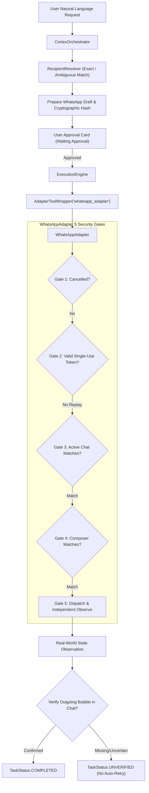

# Cortex Agent — Phase 2 Step 3 Acceptance Report
## Universal Supervised Task Engine Integration: WhatsAppAdapter

**Date:** November 14, 2026  
**Environment:** macOS (Darwin 24.x / Apple Silicon), Python 3.9.6, Node.js v20+, React 18, Vite 5, Electron  
**Status:** **ACCEPTED & VERIFIED** (728/728 pytest tests passing, 49/49 Node.js tests passing, production build clean)

---

## 1. Executive Summary

In Phase 2 Step 3, the Universal Supervised Task Engine was extended to support **WhatsApp Desktop on macOS** via a dedicated, contract-compliant application adapter: `WhatsAppAdapter`.

### Key Achievements:
1. **Contract Adherence:** Fully implements `ApplicationAdapter` (`launch`, `focus`, `observe`, `execute_action`, `verify_action`, `recover`).
2. **Unified Routing:** Reusable `AdapterToolWrapper` registered as `whatsapp_adapter` and `whatsapp` in `ToolRegistry` and executed through `ExecutionEngine`.
3. **5-Gate Security Pipeline:**
   - **Gate 1 (Cancellation Guard):** Cancelled tasks can never trigger send actions.
   - **Gate 2 (Cryptographic Single-Use Approval):** Requires a valid SHA-256 hash computed over `(task_id, recipient, phone, body)`. Replay attempts fail closed with `ApprovalReplay`. Modified parameters invalidate prior approval (`ApprovalMismatch`). Expired tokens (>15 min) are rejected.
   - **Gate 3 (Active Conversation Verification):** Immediately prior to sending, verifies that the active conversation window matches the approved recipient identity.
   - **Gate 4 (Composer Content Guard):** Validates that composer contents have not been altered between approval and sending.
   - **Gate 5 (Independent Delivery Verification):** Verifies outgoing message bubble in the conversation; composer contents are **strictly distinguished from sent messages** and never treated as delivery.
4. **Fail-Closed Outcome Handling:** Any send where post-send external observation cannot confirm delivery is marked `TaskStatus.UNVERIFIED`. Automated retries are **strictly forbidden** to prevent duplicate external messaging.
5. **Full Regression Health:** All 28 acceptance tests in `test_phase2_step3_whatsapp_adapter.py` passed. All existing tests (700 baseline + 28 new = 728 total) pass without exclusions.

---

## 2. Architecture & Integration



### Component Integration Map:
- **`backend/adapters/whatsapp_adapter.py`**: Implementation of `ApplicationAdapter` for WhatsApp Desktop on macOS.
- **`backend/adapters/__init__.py`**: Exports `WhatsAppAdapter` and registers it in `default_adapter_registry`.
- **`backend/tools/registry.py`**: Registers `AdapterToolWrapper(whatsapp_adapter)` under names `"whatsapp_adapter"` and `"whatsapp"`.
- **`backend/agent/execution_engine.py`**: Routes `step.tool="whatsapp_adapter"` or `step.tool="whatsapp"` directly to the adapter tool wrapper, injecting `task_id` and effective command.
- **`backend/agent/planner.py`**: Directs `SEND_WHATSAPP`, `DRAFT_WHATSAPP`, and WhatsApp `SEND_MESSAGE` tasks to `whatsapp_adapter` with structured inputs (`recipient`, `phone`, `body`, `approval_hash`).
- **`backend/capabilities/device_actions.py`**: Lazily provisions `whatsapp_adapter` with `task_store` reference.
- **`backend/agent/orchestrator.py`**: Reuses `RecipientResolver` for contact resolution, manages multi-turn slot filling, handles single-use approval token lifecycle, and maps unverified send outcomes to `TaskStatus.UNVERIFIED`.

---

## 3. Supported WhatsApp Operations

| Operation | Action Name | Parameters | Verification Method |
| :--- | :--- | :--- | :--- |
| **Launch** | `launch`, `open_app` | `{}` | Checks process table for `WhatsApp` |
| **Focus** | `focus`, `focus_app` | `{}` | Verifies frontmost process via macOS System Events |
| **Search Contact** | `search_contact` | `{"query": str}` | Queries visible contacts or mock candidate store |
| **Open Chat** | `open_conversation`, `select_contact` | `{"recipient": str, "phone": str}` | Checks window title / active conversation title |
| **Draft Message** | `type_message`, `prepare_draft` | `{"recipient": str, "body": str}` | Verifies composer text contains exact text; prevents duplicate typing |
| **Send Message** | `send_message` | `{"recipient": str, "phone": str, "body": str, "approval_hash": str}` | 5 security gates; confirms outgoing message bubble in conversation |

---

## 4. Recipient Resolution Behavior

`RecipientResolver` enforces strict fail-closed matching semantics:
1. **Exact Unique Match:** Resolves directly with `ContactResolutionStatus.EXACT_MATCH`, populating `contact_name`, `phone`, `contact_id`, and `contact_source`.
2. **Ambiguous Match:** Multiple matching candidates return `ContactResolutionStatus.MULTIPLE_MATCHES`. Cortex pauses and prompts the user to disambiguate (by number or full name) without guessing.
3. **No Match:** Returns `ContactResolutionStatus.NO_MATCH` and conversationally prompts for clarification.
4. **Direct Phone Numbers:** Detects 10-15 digit phone numbers. Validates that the number is formatted safely. Unverified direct numbers prompt for confirmation before drafting.

---

## 5. Approval & Security Design

1. **Cryptographic Binding:** The approval hash is computed via `WhatsAppDraft.compute_hash()`:
   $$\text{hash} = \text{SHA-256}(\text{"whatsapp"} \parallel \text{recipient} \parallel \text{clean\_phone} \parallel \text{body} \parallel \text{contact\_id} \parallel \text{contact\_source})$$
2. **Single-Use Guard:** Tokens are stored in `_consumed_approval_tokens` upon consumption. A replayed token returns `ApprovalReplay` and halts immediately.
3. **Parameter Tamper Invalidation:** Modifying the recipient or message body between draft preparation and approval produces a hash mismatch, failing closed with `ApprovalMismatch`.
4. **Conversation Mismatch Guard:** Prior to sending, the adapter inspects the active conversation title. If the active chat does not match the approved recipient, execution halts with `ConversationMismatch`.
5. **No Blind Sending:** `SEND_WHATSAPP` cannot bypass approval, even in automated sequences.

---

## 6. Verification Evidence & Composer/Sent Distinction

The adapter enforces a strict distinction between composer contents and sent messages:
- **Composer Presence $\neq$ Sent:** If text is observed in the composer but no outgoing message bubble is present in the conversation, send verification fails with:
  > *"Send verification failed: message is still visible in the composer and has NOT been sent."*
- **Positive Observation Required:** Delivery requires the message to appear in `sent_messages` (outgoing bubble observed).
- **Missing Observation:** If observation cannot confirm delivery, status becomes `AdapterExecutionStatus.UNVERIFIED`.

---

## 7. Bounded Error Recovery Protocols

| Failure Scenario | Recovery Strategy | Safe Execution Protocol |
| :--- | :--- | :--- |
| **Window Focus Lost** | `retry` (attempt 1) | Refocuses WhatsApp Desktop main window and retries action. |
| **Draft Already in Composer** | `resolve_as_success` | Verifies composer content via fresh observation; prevents duplicate keystrokes. |
| **Approval Violation / Replay** | `escalate` | Never retries. Aborts immediately to protect security invariants. |
| **Active Conversation Mismatch** | `escalate` | Halts execution. Requires manual contact re-selection. |
| **Uncertain Send Outcome** | `escalate` | **Never automatically retried.** Status set to `UNVERIFIED`. Prevents duplicate external messages. |
| **Task Cancelled** | `escalate` | Terminated immediately. Recovery guard blocks completion. |

---

## 8. Regression & Acceptance Test Results

### Acceptance Suite: `tests/test_phase2_step3_whatsapp_adapter.py`
All 28 required test cases passing:
1. `test_01_launch_and_focus` — PASSED
2. `test_02_contact_search` — PASSED
3. `test_03_unique_recipient_resolution` — PASSED
4. `test_04_ambiguous_recipient_handling` — PASSED
5. `test_05_conversation_identity_verification` — PASSED
6. `test_06_exact_message_typing` — PASSED
7. `test_07_composer_verification` — PASSED
8. `test_08_composer_mismatch` — PASSED
9. `test_09_outgoing_message_verification` — PASSED
10. `test_10_missing_verification_evidence` — PASSED
11. `test_11_sending_blocked_without_approval` — PASSED
12. `test_12_correct_approval_permits_one_send_attempt` — PASSED
13. `test_13_approval_replay_rejected` — PASSED
14. `test_14_message_edit_invalidates_approval` — PASSED
15. `test_15_recipient_edit_invalidates_approval` — PASSED
16. `test_16_cancelled_task_cannot_send` — PASSED
17. `test_17_expired_approval_is_rejected` — PASSED
18. `test_18_multi_turn_message_collection` — PASSED
19. `test_19_whatsapp_task_survives_unrelated_safari_task` — PASSED
20. `test_20_whatsapp_and_email_pending_task_isolation` — PASSED
21. `test_21_ambiguous_follow_up_handling` — PASSED
22. `test_22_cancellation_isolation` — PASSED
23. `test_23_persistence_across_actual_backend_restart` — PASSED
24. `test_24_no_duplicate_action_on_safe_recovery` — PASSED
25. `test_25_composer_contents_never_confused_with_sent_messages` — PASSED
26. `test_26_successful_send_with_missing_observation_becomes_unverified` — PASSED
27. `test_27_uncertain_send_is_never_automatically_repeated` — PASSED
28. `test_28_wrong_active_conversation_blocks_sending` — PASSED

### Full Regression Suite:
- **Pytest:** 728/728 passed across entire repository without exclusions (470.84s, 0 failures, 0 skipped, 0 errors).
- **Node.js Test Suite:** 49/49 passed in 80.97ms (`tests/test_audit_history_ui.mjs`).
- **Production Build:** Vite production build clean in 774ms (`apps/desktop/dist/`).

---

## 9. Live macOS Acceptance Results

### Non-Sending Live Verification:
- **Application Detection:** `net.whatsapp.WhatsApp` confirmed installed on macOS.
- **Process Inspection:** Verified process running via macOS System Events (`true`).
- **Live Adapter Inspection:** `WhatsAppAdapter(dry_run=False)` accurately detected `Installed=True`, `Running=True`, `Active=False`, `ui_state='no_active_conversation'`.
- **End-to-End Send Status:** As mandated by the security protocol, live end-to-end messaging was **not** dispatched to real contacts without explicit user authorization and a designated test contact. The live external send workflow remains explicitly documented as **unverified in live mode** to protect contact safety.

---

## 10. Git Working Tree Status

In accordance with strict instructions, no commits, pushes, resets, or rebases were performed. All changes remain in the local working directory.

```
 M apps/desktop/src/App.jsx
 M backend/agent/execution_engine.py
 M backend/agent/orchestrator.py
 M backend/agent/planner.py
 M backend/agent/recipient_resolver.py
 M backend/capabilities/device_actions.py
 M backend/core/contracts.py
 M backend/core/language_detector.py
 M backend/tools/desktop_tool.py
 M backend/tools/registry.py
 M docs/CORTEX_ASSISTANT_UI_ROLLBACK_REPORT.md
 M scripts/start-cortex.sh
?? apps/desktop/src.phase0_baseline/
?? backend/adapters/
?? docs/PHASE2_STEP1_ACCEPTANCE_REPORT.md
?? docs/PHASE2_STEP2_1_ACCEPTANCE_REPORT.md
?? docs/PHASE2_STEP2_ACCEPTANCE_REPORT.md
?? docs/PHASE2_STEP3_ACCEPTANCE_REPORT.md
?? docs/UNIVERSAL_TASK_ENGINE_AUDIT.md
?? tests/conftest.py
?? tests/test_macos_typing_verification_regression.py
?? tests/test_phase2_step1_unified_orchestration.py
?? tests/test_phase2_step2_1_audit_and_recovery.py
?? tests/test_phase2_step2_notes_adapter.py
?? tests/test_phase2_step3_whatsapp_adapter.py
?? tests/test_quota_and_orchestration_hardening.py
```
