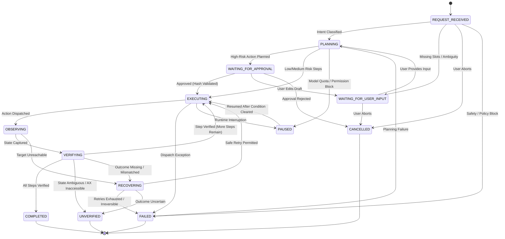

# CORTEX AGENT — UNIVERSAL SUPERVISED TASK EXECUTION
## PHASE 1: EXISTING ARCHITECTURE AUDIT & IMPLEMENTATION BLUEPRINT

**Document Version:** 1.0.0  
**Date:** November 14, 2026  
**Auditor:** Antigravity Engineering & Architecture  
**Status:** Audit Complete — Pending Implementation Review  
**Repository Working Directory:** `/Users/gsunilkumar/Desktop/antigravity/Codex/2026-06-17/files-mentioned-by-the-user-cortex`

---

## 1. Executive Summary & Audit Scope

Cortex Agent is evolving from a collection of domain-specific automation routines (such as specialized email workflows, WhatsApp scripting, and basic macOS desktop commands) into a **universal supervised desktop assistant**. 

In this target architecture:
1. Cortex understands high-level user goals across arbitrary desktop applications.
2. It conversationally clarifies missing parameters without losing state or context.
3. It decomposes requests into structured, verifiable execution plans.
4. It operates applications through a standardized, extensible **Application Adapter** architecture.
5. It enforces strict, single-use approval gates on consequential actions (sending messages, payments, destructive operations, form submissions).
6. It empirically verifies real-world outcomes using accessibility inspection and screen observation before reporting success.
7. It unifies the task lifecycle under a single robust state machine preserved across restarts.

### Audit Constraint Compliance
- **Audit Only:** Zero application source code was modified during this audit phase.
- **Architectural Preservation:** The existing foundational building blocks (`ExecutionEngine`, `PolicyEngine`, `TaskStore`, `NativeScreenHelperBridge`, `AccessibilityInspectionEngine`) are retained and leveraged rather than rebuilt.
- **Empirical Grounding:** Every statement, API, and limitation reported below is traced directly to actual source files in the repository.

---

## 2. Existing Architecture Map

### 2.1 Natural-Language Intent Detection and Routing
- **Source Files:**
  - [`backend/agent/orchestrator.py`](file:///Users/gsunilkumar/Desktop/antigravity/Codex/2026-06-17/files-mentioned-by-the-user-cortex/backend/agent/orchestrator.py#L512-L605) (`_analyze_intent`, `_analyze_intent_fallback`)
  - [`backend/core/contracts.py`](file:///Users/gsunilkumar/Desktop/antigravity/Codex/2026-06-17/files-mentioned-by-the-user-cortex/backend/core/contracts.py#L1120-L1210) (`command_from_intent`)
  - [`backend/core/language_detector.py`](file:///Users/gsunilkumar/Desktop/antigravity/Codex/2026-06-17/files-mentioned-by-the-user-cortex/backend/core/language_detector.py#L1-L150) (`detect_language`)
- **Key Functions & APIs:**
  - `_analyze_intent(message: str, lang_code: str = "en") -> dict[str, Any]`
  - `command_from_intent(text: str) -> TaskCommand`
  - `detect_language(text: str, client: Any = None) -> LanguageCode`
- **Current Mechanics:**
  Intent classification operates in a dual mode. First, it attempts a structured JSON call via Google Gemini (`gemini-2.5-flash`), instructing the model to output a schema containing `command`, `confidence`, `risk_level`, `requires_approval`, and `params`. If Gemini is unavailable, in a 429 quota exhaustion cooldown, or `use_gemini=False`, it immediately falls back to `_analyze_intent_fallback()` and `command_from_intent()`, which evaluates a comprehensive set of priority regex rules.
- **Current Limitations:**
  - **Parameter Extraction Fragmentation:** Extraction is split across three uncoordinated places: `_analyze_intent()` returns partial params, `_extract_params()` in `orchestrator.py` runs ad-hoc regex, and capability methods (e.g., `_type_text`, `email_engine.py`, `whatsapp_actions.py`) perform secondary parsing.
  - **No Dynamic Slot Extraction:** Complex goals spanning multiple targets (e.g., "Find the quarterly report in Downloads and email it to Sunil") lose compound parameter relationships.

---

### 2.2 Task Planning and Orchestration
- **Source Files:**
  - [`backend/agent/planner.py`](file:///Users/gsunilkumar/Desktop/antigravity/Codex/2026-06-17/files-mentioned-by-the-user-cortex/backend/agent/planner.py#L12-L350) (`AutonomousPlanner.plan`)
  - [`backend/agent/execution_engine.py`](file:///Users/gsunilkumar/Desktop/antigravity/Codex/2026-06-17/files-mentioned-by-the-user-cortex/backend/agent/execution_engine.py#L40-L200) (`ExecutionEngine.execute_plan`)
  - [`backend/agent/orchestrator.py`](file:///Users/gsunilkumar/Desktop/antigravity/Codex/2026-06-17/files-mentioned-by-the-user-cortex/backend/agent/orchestrator.py#L1956-L2645) (`chat`, `_chat_sequence`, `_execute`)
- **Key Functions & APIs:**
  - `AutonomousPlanner.plan(goal, command, params, context) -> Plan`
  - `ExecutionEngine.execute_plan(task, on_progress) -> FinalResult`
  - `CortexOrchestrator._chat_sequence(original_message, commands, source) -> dict`
- **Current Mechanics:**
  `AutonomousPlanner` generates a sequential `Plan` of `PlanStep` items. Each step specifies the `tool`, `inputs`, `expected_result`, `risk_level`, `approval_required`, and `verification_method`. `ExecutionEngine` executes steps in a loop: `EXECUTE -> OBSERVE -> VERIFY -> RECOVER/RETRY`.
- **Current Limitations:**
  - **Severe Architectural Disconnect (Dual Execution Path):**
    While `ExecutionEngine` exists and implements the correct observe/verify loop, `orchestrator.py` frequently **bypasses it**:
    - Compound commands invoke `_chat_sequence()`, which calls `self.automation.execute()` directly in a custom loop.
    - Commands like `SEARCH_FILES`, `DRAFT_MAIL`, `SUMMARIZE_MAIL`, `READ_MAIL`, and `WRITE_NOTE` are intercepted inside `_execute()` in `orchestrator.py` and run via one-off custom branches.
    - Only unhandled commands fall through to `self.execution_engine.execute_plan(task)`.
  - **Static Planning:** `AutonomousPlanner` relies on hardcoded `if/elif` ladders based on `command`. It does not support dynamically synthesized multi-application plans.

---

### 2.3 Multi-Turn Conversation and Context Retention
- **Source Files:**
  - [`backend/agent/orchestrator.py`](file:///Users/gsunilkumar/Desktop/antigravity/Codex/2026-06-17/files-mentioned-by-the-user-cortex/backend/agent/orchestrator.py#L445-L463, #L850-L1490)
  - [`backend/core/contracts.py`](file:///Users/gsunilkumar/Desktop/antigravity/Codex/2026-06-17/files-mentioned-by-the-user-cortex/backend/core/contracts.py#L362-L394) (`TaskContext`)
- **Key Functions & APIs:**
  - `self.pending_action: dict[str, Any] | None`
  - `self.history: list[dict[str, Any]]`
  - `_load_history()`, `_save_history()`
  - `_is_unrelated_turn(message: str, step: str = "") -> bool`
  - `_is_explicit_cancellation(message: str, in_pending: bool = False) -> bool`
- **Current Mechanics:**
  Conversation turns are maintained in `self.history` and persisted to SQLite table `memories`. In-progress multi-turn operations (e.g., gathering email recipient, subject, and body, or selecting a WhatsApp contact) are tracked in `self.pending_action`.
- **Current Limitations:**
  - **Single Slot-Filling Task Bottleneck:** `self.pending_action` is a single variable. If a user is clarifying an email draft and asks "What's the weather?" or "Open Notes", the system either treats it as an "unrelated turn" and refuses to branch, or destroys the pending task state.
  - **Hardcoded Domain Logic:** Over 600 lines in `orchestrator.py` handle mail and WhatsApp slot filling specifically. There is no generalized conversational slot-filling abstraction for other desktop tasks.
  - **Volatile Pending Actions:** If the process terminates while `self.pending_action` is active before task persistence, the conversational slot state is lost.

---

### 2.4 Task State Management and Persistence
- **Source Files:**
  - [`backend/core/contracts.py`](file:///Users/gsunilkumar/Desktop/antigravity/Codex/2026-06-17/files-mentioned-by-the-user-cortex/backend/core/contracts.py#L19-L57, #L782-L910) (`Task`, `TaskStatus`)
  - [`backend/persistence/task_store.py`](file:///Users/gsunilkumar/Desktop/antigravity/Codex/2026-06-17/files-mentioned-by-the-user-cortex/backend/persistence/task_store.py#L140-L280) (`TaskStore`)
  - [`backend/persistence/encrypted_store.py`](file:///Users/gsunilkumar/Desktop/antigravity/Codex/2026-06-17/files-mentioned-by-the-user-cortex/backend/persistence/encrypted_store.py#L1-L150) (`EncryptedMemoryStore`)
  - [`backend/agent/orchestrator.py`](file:///Users/gsunilkumar/Desktop/antigravity/Codex/2026-06-17/files-mentioned-by-the-user-cortex/backend/agent/orchestrator.py#L370-L440) (`_rehydrate_tasks`)
- **Key Functions & APIs:**
  - `Task.transition_to(target: TaskStatus, reason: str, force_admin: bool)`
  - `TaskStore.save_task(task: Task)`, `TaskStore.get_task(task_id: str)`
  - `TaskStore.record_action_attempt(attempt: ActionAttempt)`
  - `CortexOrchestrator._rehydrate_tasks()`
- **Current Mechanics:**
  Cortex maintains dual persistence: an encrypted KV store (`memory.sqlite3`) and a relational SQLite store (`tasks.sqlite3`). State changes invoke `Task.transition_to()`, which validates transitions against `ALLOWED_TRANSITIONS`. On startup, `_rehydrate_tasks()` inspects executing tasks and transitions unconfirmed actions to `NEEDS_ATTENTION` or `PAUSED`.
- **Current Limitations:**
  - **Status Enum Duplication & Synonyms:** The codebase defines multiple overlapping state names (`WAITING_APPROVAL` vs `AWAITING_APPROVAL`, `CANCELLED` vs `CANCELED`, `RUNNING` vs `EXECUTING`).
  - **Absence of Unified Universal States:** States like `WAITING_FOR_USER_INPUT` are coerced to `AWAITING_CLARIFICATION`, and `UNVERIFIED` is aliased to `NEEDS_ATTENTION`.
  - **Relational Store Incompleteness:** While `TaskStore` defines rich relational tables (`task_steps`, `approvals`, `action_attempts`, `recovery_checkpoints`), several high-level paths in `orchestrator.py` only persist to the KV store via `self._persist_task()`, leaving relational tables populated unevenly.

---

### 2.5 macOS Application Control
- **Source Files:**
  - [`backend/capabilities/device_actions.py`](file:///Users/gsunilkumar/Desktop/antigravity/Codex/2026-06-17/files-mentioned-by-the-user-cortex/backend/capabilities/device_actions.py#L744-L1140) (`resolve_app_name`, `is_app_running`, `_open_app`, `_focus_app`, `_close_app`, `_close_window`, `_inspect_app`)
  - [`backend/capabilities/screen_native.py`](file:///Users/gsunilkumar/Desktop/antigravity/Codex/2026-06-17/files-mentioned-by-the-user-cortex/backend/capabilities/screen_native.py#L105-L250) (`NativeScreenHelperBridge`)
- **Key Functions & APIs:**
  - `device.resolve_app_name(app_name: str) -> str`
  - `device.is_app_running(app_name: str) -> bool`
  - `device.is_app_active(app_name: str) -> bool`
  - `device._open_app(app_name: str, folder: str = "") -> DeviceActionResult`
  - `device._focus_app(app_name: str) -> DeviceActionResult`
- **Current Mechanics:**
  Application discovery uses an internal `APP_ALIASES` map supplemented by `ApplicationDiscovery` querying macOS Spotlight (`mdfind`) and bundle identifiers. Process detection queries `NSRunningApplication` via `cortex_screen_helper` with fallback to `pgrep` and System Events AppleScript. Focus operations activate the app and poll the frontmost process.
- **Current Limitations:**
  - **Window vs Element Focus Confusion:** Activating an application focuses its process, but almost never focuses the intended interactive UI element (e.g. Note body editor, Search bar, Chat input).
  - **Monolithic Bloat:** All OS controls live inside the 2,500-line `DeviceAutomation` class. There is no clean separation between OS-level lifecycle management and app-specific automation.

---

### 2.6 Screen Observation and Accessibility
- **Source Files:**
  - [`backend/capabilities/screen_native.py`](file:///Users/gsunilkumar/Desktop/antigravity/Codex/2026-06-17/files-mentioned-by-the-user-cortex/backend/capabilities/screen_native.py#L105-L350) (`NativeScreenHelperBridge`)
  - [`backend/capabilities/screen_accessibility.py`](file:///Users/gsunilkumar/Desktop/antigravity/Codex/2026-06-17/files-mentioned-by-the-user-cortex/backend/capabilities/screen_accessibility.py#L141-L320) (`AccessibilityInspectionEngine`)
  - [`backend/capabilities/screen_context.py`](file:///Users/gsunilkumar/Desktop/antigravity/Codex/2026-06-17/files-mentioned-by-the-user-cortex/backend/capabilities/screen_context.py#L163-L280) (`ScreenContextFusionEngine`)
  - [`backend/capabilities/screen_element_resolver.py`](file:///Users/gsunilkumar/Desktop/antigravity/Codex/2026-06-17/files-mentioned-by-the-user-cortex/backend/capabilities/screen_element_resolver.py#L38-L190) (`UIElementResolver`)
- **Key Functions & APIs:**
  - `screen_bridge.capture_screen_context() -> dict`
  - `ax_engine.inspect_window(pid, max_depth) -> AccessibilityPerceptionResult`
  - `fusion_engine.fuse(ax_elements, ocr_blocks) -> ScreenContext`
  - `element_resolver.resolve(query, screen_context) -> ResolvedElementTarget`
- **Current Mechanics:**
  Combines macOS Accessibility APIs (`AXUIElementCopyAttributeValue`) via a native Swift/ObjC binary with macOS Vision Framework OCR. Elements are normalized into roles (`button`, `text_field`, `scroll_area`, etc.) and indexed spatially.
- **Current Limitations:**
  - **Underutilized by Tasks:** Despite sophisticated screen perception code, task workflows (email, notes, web) rarely call `fusion_engine.fuse()`. Instead, they invoke bespoke AppleScript snippets (`tell process "Notes" to get value of text area 1`).
  - **Traverse Performance:** Deep AX trees in Electron or web-wrapper apps can cause perceptible lag (1–3 seconds) if traversed without target bounding boxes.

---

### 2.7 Keyboard and Mouse Automation
- **Source Files:**
  - [`backend/capabilities/device_actions.py`](file:///Users/gsunilkumar/Desktop/antigravity/Codex/2026-06-17/files-mentioned-by-the-user-cortex/backend/capabilities/device_actions.py#L1510-L1770) (`_type_text`, `_type_text_macos_notes`, `_type_text_macos_generic`, `_keystroke`, `_menu_item`)
  - [`backend/capabilities/screen_interaction_engine.py`](file:///Users/gsunilkumar/Desktop/antigravity/Codex/2026-06-17/files-mentioned-by-the-user-cortex/backend/capabilities/screen_interaction_engine.py#L79-L210) (`DesktopInteractionEngine`)
- **Key Functions & APIs:**
  - `_type_text(text: str, app_name: str = "") -> DeviceActionResult`
  - `_keystroke(shortcut: str, app_name: str = "") -> DeviceActionResult`
  - `DesktopInteractionEngine.interact(request: InteractionRequest) -> InteractionResult`
- **Current Mechanics:**
  Text entry uses AppleScript `keystroke` through `System Events`. For Apple Notes, element-level targeting focuses `AXTextArea` and reads back value to verify. `DesktopInteractionEngine` supports AXPress (`AXUIElementPerformAction`) and hardware mouse clicks via `CGEventCreateMouseEvent`.
- **Current Limitations:**
  - **No Standard Virtual Input Interface:** Direct string typing vs. shortcut dispatch vs. synthetic clicks are split between `device_actions.py` and `screen_interaction_engine.py`.
  - **Non-ASCII Text Entry:** AppleScript `keystroke` fails or mangles emojis and non-Latin character sets unless routed through the macOS clipboard.

---

### 2.8 WhatsApp Automation
- **Source Files:**
  - [`backend/capabilities/whatsapp_actions.py`](file:///Users/gsunilkumar/Desktop/antigravity/Codex/2026-06-17/files-mentioned-by-the-user-cortex/backend/capabilities/whatsapp_actions.py#L370-L1050) (`WhatsAppDesktopAdapter`, `WhatsAppAutomation`)
  - [`backend/agent/recipient_resolver.py`](file:///Users/gsunilkumar/Desktop/antigravity/Codex/2026-06-17/files-mentioned-by-the-user-cortex/backend/agent/recipient_resolver.py#L1-L450) (`RecipientResolver`)
- **Key Functions & APIs:**
  - `WhatsAppAutomation.prepare_draft(recipient, phone, body) -> dict`
  - `WhatsAppAutomation.send_message(recipient, phone, body, approved_hash, task_id) -> dict`
  - `WhatsAppDesktopAdapter.observe_current_conversation() -> WhatsAppConversationObservation`
  - `WhatsAppDesktopAdapter.execute_send(attempt, approved_hash) -> dict`
- **Current Mechanics:**
  Inspects WhatsApp Desktop through native Accessibility queries. Searches contacts in the UI search field, selects the verified conversation bubble, populates the message composer, requests user approval with a cryptographic SHA-256 hash, and sends only after explicit single-use approval.
- **Current Limitations:**
  - **Bespoke Architecture:** WhatsApp automation is implemented as an isolated silo with custom candidate models (`WhatsAppCandidate`), custom observation models (`WhatsAppConversationObservation`), and custom send attempts (`WhatsAppSendAttempt`) that share nothing with email or notes.
  - **Desktop App Fragility:** Changes in the WhatsApp Electron/Catalyst UI structure require manual patch updates in selector paths.

---

### 2.9 Apple Mail and Gmail Automation
- **Source Files:**
  - [`backend/capabilities/mail_actions.py`](file:///Users/gsunilkumar/Desktop/antigravity/Codex/2026-06-17/files-mentioned-by-the-user-cortex/backend/capabilities/mail_actions.py#L36-L740) (`MailActions`)
  - [`backend/agent/email_engine.py`](file:///Users/gsunilkumar/Desktop/antigravity/Codex/2026-06-17/files-mentioned-by-the-user-cortex/backend/agent/email_engine.py#L1-L1400) (`IntelligentEmailEngine`)
  - [`backend/tools/mail_tool.py`](file:///Users/gsunilkumar/Desktop/antigravity/Codex/2026-06-17/files-mentioned-by-the-user-cortex/backend/tools/mail_tool.py#L1-L320) (`MailTool`)
- **Key Functions & APIs:**
  - `mail.create_email_draft(recipient, subject, body, account, ...) -> DeviceActionResult`
  - `mail.send_mail(recipient, subject, body, account, ...) -> DeviceActionResult`
  - `mail.verify_mail_sent(recipient, subject, account) -> dict`
  - `mail.verify_draft_created(recipient, subject, body, account) -> dict`
- **Current Mechanics:**
  Multi-account email engine supporting Apple Mail (via native AppleScript) and Gmail (via Google OAuth REST API). Drafts are verified in the Drafts folder. Sends require explicit user approval. Post-send verification queries the provider's Sent mailbox within a time window.
- **Current Limitations:**
  - **Duplicated Orchestration Engine:** `email_engine.py` (1,400 lines) contains its own conversational slot-filling state machine, tone analyzer, and approval formatter, entirely duplicating functionality found in `orchestrator.py`.

---

### 2.10 Browser Automation
- **Source Files:**
  - [`backend/capabilities/browser_actions.py`](file:///Users/gsunilkumar/Desktop/antigravity/Codex/2026-06-17/files-mentioned-by-the-user-cortex/backend/capabilities/browser_actions.py#L30-L115) (`BrowserActions`)
  - [`backend/tools/browser_tool.py`](file:///Users/gsunilkumar/Desktop/antigravity/Codex/2026-06-17/files-mentioned-by-the-user-cortex/backend/tools/browser_tool.py#L1-L110) (`BrowserTool`)
- **Key Functions & APIs:**
  - `browser.open_url(url: str) -> BrowserResult`
  - `browser.click(selector: str, url: str) -> BrowserResult`
  - `browser.type_text(selector: str, text: str, url: str) -> BrowserResult`
  - `browser.scrape(url: str, selector: str) -> BrowserResult`
- **Current Mechanics:**
  Launches a background Playwright Chromium instance to navigate URLs, click CSS selectors, fill input fields, and scrape text.
- **Current Limitations:**
  - **Decoupled from User's Desktop Browser:** Playwright runs in an isolated sandbox. It cannot interact with tabs or authenticated sessions in the user's everyday browser (Safari, Chrome, Arc).
  - **CSS Selector Fragility:** Desktop users give natural language goals ("Click the download link for macOS"), but `BrowserActions` requires explicit CSS selectors. It lacks vision- or AX-based web navigation.

---

### 2.11 Approval and Permission Management
- **Source Files:**
  - [`backend/agent/policy.py`](file:///Users/gsunilkumar/Desktop/antigravity/Codex/2026-06-17/files-mentioned-by-the-user-cortex/backend/agent/policy.py#L65-L247) (`PolicyEngine`, `PolicyRule`)
  - [`backend/core/contracts.py`](file:///Users/gsunilkumar/Desktop/antigravity/Codex/2026-06-17/files-mentioned-by-the-user-cortex/backend/core/contracts.py#L702-L722) (`ApprovalRequest`)
  - [`backend/agent/orchestrator.py`](file:///Users/gsunilkumar/Desktop/antigravity/Codex/2026-06-17/files-mentioned-by-the-user-cortex/backend/agent/orchestrator.py#L2682-L2940) (`approve`)
- **Key Functions & APIs:**
  - `policy.evaluate(command, intent, params) -> (RiskLevel, requires_approval, block_reason)`
  - `policy.compute_idempotency_key(command, params) -> str`
  - `orchestrator.approve(task_id: str, approved: bool, approval_hash: str | None) -> dict`
- **Current Mechanics:**
  Actions have a classified `RiskLevel` (LOW, MEDIUM, HIGH, BLOCKED). Consequential actions (`SEND_MAIL`, `SEND_WHATSAPP`, `SHUTDOWN`, `RESTART`) require explicit approval. A single-use SHA-256 hash is computed over the payload. On approval, the hash is validated and consumed immediately; parameter edits invalidate the token.
- **Current Limitations:**
  - **Inconsistent Hash Computation:** WhatsApp hashes `phone + body`; Email hashes `recipient + subject + body + account`; other tasks use generic parameters.
  - **Missing Approval Card Types:** The frontend only renders rich approval banners for WhatsApp and Email. There are no approval card schemas for payments, file deletions, form submissions, or system config changes.

---

### 2.12 Action-Level Verification
- **Source Files:**
  - [`backend/agent/execution_engine.py`](file:///Users/gsunilkumar/Desktop/antigravity/Codex/2026-06-17/files-mentioned-by-the-user-cortex/backend/agent/execution_engine.py#L115-L160) (`_verify_step`)
  - [`backend/tools/base.py`](file:///Users/gsunilkumar/Desktop/antigravity/Codex/2026-06-17/files-mentioned-by-the-user-cortex/backend/tools/base.py#L40-L65) (`BaseTool.verify`)
  - [`backend/tools/desktop_tool.py`](file:///Users/gsunilkumar/Desktop/antigravity/Codex/2026-06-17/files-mentioned-by-the-user-cortex/backend/tools/desktop_tool.py#L125-L250) (`verify`)
  - [`backend/capabilities/device_actions.py`](file:///Users/gsunilkumar/Desktop/antigravity/Codex/2026-06-17/files-mentioned-by-the-user-cortex/backend/capabilities/device_actions.py#L1550-L1675) (`_type_text_macos_notes`)
- **Key Functions & APIs:**
  - `tool.observe(inputs, execution_result) -> Observation`
  - `tool.verify(inputs, observation, execution_result) -> VerificationResult`
  - `mail.verify_mail_sent()`, `whatsapp.observe_current_conversation()`
- **Current Mechanics:**
  Separates `ExecutionResult` (did the command run?) from `Observation` (what is the OS state?) and `VerificationResult` (did the desired real-world effect occur?). Notes reads `AXTextArea` content; Mail inspects the Sent mailbox; WhatsApp checks conversation bubbles; Files inspects SHA-256 or filesystem existence.
- **Current Limitations:**
  - **Uneven Implementation:** Specific operations (Notes text typing, Mail sending, WhatsApp sending) have rigorous verification, but general app actions (menu selection, generic clicks, window actions) fall back to assuming exit code `0` is verified.

---

### 2.13 Error Handling, Recovery and Checkpoints
- **Source Files:**
  - [`backend/agent/execution_engine.py`](file:///Users/gsunilkumar/Desktop/antigravity/Codex/2026-06-17/files-mentioned-by-the-user-cortex/backend/agent/execution_engine.py#L145-L185)
  - [`backend/tools/base.py`](file:///Users/gsunilkumar/Desktop/antigravity/Codex/2026-06-17/files-mentioned-by-the-user-cortex/backend/tools/base.py#L66-L80) (`BaseTool.recover`)
  - [`backend/persistence/task_store.py`](file:///Users/gsunilkumar/Desktop/antigravity/Codex/2026-06-17/files-mentioned-by-the-user-cortex/backend/persistence/task_store.py#L272-L280) (`recovery_checkpoints`)
- **Key Functions & APIs:**
  - `tool.recover(inputs, error, attempt) -> dict`
  - `policy.check_duplicate_or_uncertain(idempotency_key) -> DuplicateCheckResult`
  - `TaskStore.save_checkpoint(checkpoint)`
- **Current Mechanics:**
  If verification fails on a step, `ExecutionEngine` checks if the action is reversible and within max retries. It consults `tool.recover()` to determine strategy (`retry`, `resolve_as_success`, `abort`).
- **Current Limitations:**
  - **Checkpoints Unlinked from Rehydration:** Checkpoints are stored in the database, but `_rehydrate_tasks()` does not reconstruct or resume execution from them. Interrupted tasks are simply marked `NEEDS_ATTENTION`.

---

### 2.14 Frontend Task Progress and Interaction UI
- **Source Files:**
  - [`apps/desktop/src/App.jsx`](file:///Users/gsunilkumar/Desktop/antigravity/Codex/2026-06-17/files-mentioned-by-the-user-cortex/apps/desktop/src/App.jsx#L158-L390, #L873-L950, #L1040-L1900)
  - [`apps/desktop/src/styles.css`](file:///Users/gsunilkumar/Desktop/antigravity/Codex/2026-06-17/files-mentioned-by-the-user-cortex/apps/desktop/src/styles.css#L1-L1500)
  - [`backend/api/server.py`](file:///Users/gsunilkumar/Desktop/antigravity/Codex/2026-06-17/files-mentioned-by-the-user-cortex/backend/api/server.py#L146-L230)
- **Key Components & Endpoints:**
  - `ResponseCard`, `EditDraftModal`, `AuditEventCard`, `AuditHistoryPanel`, `LanguageBadge`
  - `POST /chat`, `POST /tasks/{task_id}/approve`, `POST /tasks/{task_id}/cancel`, `POST /tasks/{task_id}/edit`
- **Current Mechanics:**
  Single-page React desktop application. Displays conversational turns, live voice/audio controls, structured approval cards for email/WhatsApp drafts, task step progress indicators, and an expandable audit history drawer.
- **Current Limitations:**
  - **Hardcoded Approval Card Branching:** `ResponseCard` explicitly branches on `task.command === "send_whatsapp"` or `"send_mail"`. Generic tasks requiring approval render generic unstyled text.
  - **No Streaming Step Progress:** The frontend only updates when `/chat` returns or when manually polling `/tasks`. Long-running multi-step tasks show a static spinner.

---

## 3. Reusable Infrastructure

Cortex possesses strong foundational modules that **must not be duplicated or discarded**:

| Reusable Component | Location | Role in Universal Engine |
| :--- | :--- | :--- |
| **`ExecutionEngine`** | `backend/agent/execution_engine.py` | Canonical step execution, real-world observation, verification, and recovery loop. |
| **`PolicyEngine`** | `backend/agent/policy.py` | Risk classification, idempotency computation, duplicate detection, and permission evaluation. |
| **`TaskStore`** | `backend/persistence/task_store.py` | Relational SQLite persistence for tasks, steps, action attempts, approvals, and audit events. |
| **`EncryptedMemoryStore`** | `backend/persistence/encrypted_store.py` | Fast KV memory storage and conversation history persistence. |
| **`NativeScreenHelperBridge`** | `backend/capabilities/screen_native.py` | Native macOS Cocoa process and window inspection (`cortex_screen_helper`). |
| **`AccessibilityInspectionEngine`** | `backend/capabilities/screen_accessibility.py` | Direct macOS AXUIElement inspection and UI tree normalization. |
| **`ScreenContextFusionEngine`** | `backend/capabilities/screen_context.py` | Multimodal fusion of accessibility tree nodes and Vision OCR text. |
| **`UIElementResolver`** | `backend/capabilities/screen_element_resolver.py` | Natural-language spatial resolution of UI targets to coordinates and AX elements. |
| **`RecipientResolver`** | `backend/agent/recipient_resolver.py` | Contact disambiguation across system contacts, email, and WhatsApp. |

---

## 4. Current Architectural Limitations & Fragmentation Root Causes

```
┌─────────────────────────────────────────────────────────────────────────────┐
│                       CURRENT FRAGMENTED ARCHITECTURE                       │
└─────────────────────────────────────────────────────────────────────────────┘

       User Message: "Send email to Sunil"      User Message: "Open Notes & type text"
                        │                                          │
                        ▼                                          ▼
             orchestrator.chat()                        orchestrator.chat()
                        │                                          │
            [email_engine.py Branch]                    [_chat_sequence Branch]
                        │                                          │
            - Custom slot filling                       - Custom while loop
            - Custom draft persistence                  - Ad-hoc app propagation
            - Custom approval card                      - Bypasses ExecutionEngine
            - Direct mail_actions call                  - Direct device_actions call
                        │                                          │
                        ▼                                          ▼
            Mail Sentbox Verification                   AppleScript AX Check
```

### The 4 Fundamental Flaws of the Current Implementation
1. **Siloed Domain Execution:** Mail, WhatsApp, Notes, Browser, and Terminal operations follow completely different code paths through `orchestrator.py` instead of passing through a unified planning and execution pipeline.
2. **Bypassed Execution Engine:** `ExecutionEngine` was built to enforce `OBSERVE -> VERIFY`, but high-level sequence requests bypass it in favor of direct calls to `self.automation.execute()`.
3. **Conversational State Rigidity:** `self.pending_action` only supports one in-memory domain flow at a time. Multi-turn interactions cannot pause, fork, or resume.
4. **Adapter Inconsistency:** There is no standard `ApplicationAdapter` interface. Every application capability defines its own function signatures, observation data shapes, and verification methods.

---

## 5. Universal Task Lifecycle & State Machine

### 5.1 Formal States Definition

The Universal Task Engine consolidates all task execution under **11 canonical states**:

1. **`REQUEST_RECEIVED`:** Task initialized from user intent; inputs cataloged.
2. **`PLANNING`:** Goal decomposed into ordered, verifiable `PlanStep` actions.
3. **`WAITING_FOR_USER_INPUT`:** Task paused waiting for missing parameters, disambiguation, or clarification.
4. **`WAITING_FOR_APPROVAL`:** Consequential action proposed; awaiting explicit user approval.
5. **`EXECUTING`:** An individual step is currently dispatching actions to the target application adapter.
6. **`OBSERVING`:** Reading external OS/application state post-action via accessibility or APIs.
7. **`VERIFYING`:** Comparing observed state against `expected_outcome` with proof.
8. **`RECOVERING`:** Action or verification failed; attempting bounded safe retry or diagnostic recovery.
9. **`COMPLETED`:** All required steps executed and verified with empirical evidence.
10. **`FAILED`:** Action execution failed, recovery exhausted, or safety constraint violated.
11. **`CANCELLED`:** User explicitly aborted task before or during execution.
12. **`PAUSED`:** Execution safely suspended due to external conditions (model quota 429, missing OS permissions).
13. **`UNVERIFIED`:** Action executed at the OS level, but application state cannot confirm outcome. Requires user attention.

---

### 5.2 State Transition Matrix & Invariants



### 5.3 Mandatory Lifecycle Invariants
1. **No False Completion:** A task can transition to `COMPLETED` **if and only if** every plan step has a `VerificationResult(verified=True)`.
2. **Single-Use Approval:** `WAITING_FOR_APPROVAL -> EXECUTING` consumes and destroys the cryptographic hash. A second action cannot execute on the same token.
3. **Context Preservation Across Restarts:** Every transition persists to `TaskStore`. A restarted process rehydrates tasks in `WAITING_FOR_APPROVAL`, `PAUSED`, or `UNVERIFIED` without repeating executed steps.

---

## 6. Application Adapter Architecture

### 6.1 Unified `ApplicationAdapter` Interface Contract

All desktop targets implement a common abstract contract:

```python
class ApplicationAdapter(ABC):
    """Universal interface for application-specific desktop adapters."""
    
    @property
    @abstractmethod
    def app_name(self) -> str:
        """Canonical application title (e.g., 'Notes', 'WhatsApp', 'Mail', 'Safari')."""
        pass

    @abstractmethod
    def is_installed(self) -> bool:
        """Determines whether application is installed on host OS."""
        pass

    @abstractmethod
    def is_running(self) -> bool:
        """Determines whether application process is active."""
        pass

    @abstractmethod
    def launch(self) -> AdapterResult:
        """Launches application and waits until main window is ready."""
        pass

    @abstractmethod
    def focus(self) -> AdapterResult:
        """Brings application to foreground and focuses active container."""
        pass

    @abstractmethod
    def observe(self, target_context: dict[str, Any] | None = None) -> AdapterObservation:
        """Captures real-world application state via Accessibility, DOM, or APIs."""
        pass

    @abstractmethod
    def execute_action(self, action: str, params: dict[str, Any]) -> AdapterResult:
        """Executes a target action (e.g. search, type, click, compose, send)."""
        pass

    @abstractmethod
    def verify_action(self, action: str, params: dict[str, Any], observation: AdapterObservation) -> VerificationResult:
        """Empirically validates action outcome using observation evidence."""
        pass

    @abstractmethod
    def recover(self, action: str, params: dict[str, Any], error: ExecutionError, attempt: int) -> RecoveryDirective:
        """Determines bounded recovery strategy when execution or verification fails."""
        pass
```

### 6.2 Adapter Capability Matrix

| Adapter | Primary Mechanism | Fallback Mechanism | Observation Method | Verification Strategy | Approval Required |
| :--- | :--- | :--- | :--- | :--- | :--- |
| **Apple Notes** | macOS AXUIElement (`AXTextArea`) | AppleScript ScriptingBridge | AX Tree inspects note editor value | String presence check in note editor | No (Reversible) |
| **WhatsApp** | WhatsApp Desktop AX Tree | Universal URL Scheme / Web | AX Tree inspects conversation bubbles | Message text appears in active bubble | **YES (High Risk)** |
| **Apple Mail** | AppleScript Mail Suite | AX UI Scripting | Sent Mailbox query via AppleScript | Message found in Sent box within window | **YES (High Risk)** |
| **Gmail** | Google Gmail API (OAuth) | Browser / IMAP | `users.messages.list` (Sent label) | RFC822 message ID / thread query | **YES (High Risk)** |
| **Browser (User)** | Native Safari/Chrome AX + AppleScript | Playwright Headed Bridge | AX Tab tree + DOM extraction | URL / Page Title / DOM element shift | Form Submit / Buy |
| **General macOS** | Cocoa `NSRunningApplication` + AX | CGEvent / System Events | AccessibilityInspectionEngine | AX Attribute inspection / Process status | Shutdown / Destructive |

---

## 7. Permission, Safety & Security Model

### 7.1 Single-Use Cryptographic Approval Hashes
Every consequential action requiring user approval generates a deterministic SHA-256 hash:
$$\text{ApprovalHash} = \text{SHA-256}\left(\text{task\_id} \parallel \text{action} \parallel \text{recipient} \parallel \text{payload} \parallel \text{account} \parallel \text{salt}\right)$$

### 7.2 Safety Invalidation Invariants
1. **Parameter Change Invalidation:** If a user edits a recipient, email subject, note body, or message text, the previous hash is invalidated. A fresh token is computed, requiring renewed approval.
2. **Single Execution Invalidation:** The moment `execute_action()` is dispatched, the token is recorded in `TaskStore.approvals` as `CONSUMED`. Replaying the token returns `HTTP 409 Conflict`.
3. **No Automatic Approval on Recovery:** If an approved action fails during dispatch or verification, recovery routines **never** bypass the approval gate to attempt variant actions.
4. **Destructive & Financial Operations Hard-Blocked:** Actions involving `format disk`, `rm -rf`, `wire money`, or `purchase` remain strictly blocked by `PolicyEngine`.

---

## 8. Action Verification Model

### 8.1 5-Level Action Classification
To prevent false task completion, actions pass through five distinct states:

```
[1. ATTEMPTED] ──> [2. EXECUTED] ──> [3. VERIFIED]  (Task = COMPLETED)
                        │
                        ├──> [4. UNVERIFIED] (Task = NEEDS_ATTENTION / UNVERIFIED)
                        │
                        └──> [5. FAILED]     (Task = FAILED)
```

1. **`ATTEMPTED`:** Parameter validation passed; OS dispatch requested.
2. **`EXECUTED`:** OS subsystem, AppleScript, or API returned exit code `0` or HTTP `200`.
3. **`VERIFIED`:** Independent observation confirmed the target state shift in application data.
4. **`UNVERIFIED`:** Action was executed, but target application does not expose accessibility or API confirmation. Cortex flags the task honestly.
5. **`FAILED`:** Action returned an error or verification confirmed the state did not change.

---

## 9. Prioritized Implementation Roadmap

### Phase 1: Core Architecture & Reusable Engine (P0)
- **Goal:** Unify `orchestrator.py`, `execution_engine.py`, and `planner.py` under the canonical 11-state lifecycle.
- **Milestones:**
  1. Deprecate custom execution branches in `_execute()` and `_chat_sequence()`; route all tasks through `ExecutionEngine`.
  2. Implement `ApplicationAdapter` abstract base class and registration registry.
  3. Wire `TaskContext` and conversational slot filling into a generic, multi-turn task session manager.

### Phase 2: Application Adapter Refactoring (P1)
- **Goal:** Migrate WhatsApp, Mail, Notes, Browser, and macOS apps into standardized adapters.
- **Milestones:**
  1. Refactor `device_actions.py` Notes logic into `NotesAdapter`.
  2. Refactor `whatsapp_actions.py` into `WhatsAppAdapter`.
  3. Refactor `mail_actions.py` into `EmailAdapter` (supporting both Apple Mail and Gmail).
  4. Create `GeneralMacOSAdapter` for window/app/keystroke control.

### Phase 3: Verification & Approval Hardening (P1/P2)
- **Goal:** Enforce empirical verification and universal approval cards across all adapters.
- **Milestones:**
  1. Standardize cryptographic token generation across all high-risk adapters.
  2. Implement adapter-level `verify_action()` with fallback to `UNVERIFIED`.
  3. Expose universal approval schemas to `apps/desktop/src/App.jsx`.

### Phase 4: UX & Conversational Polish (P2/P3)
- **Goal:** Real-time progress updates, multi-task switching, and active browser bridge.
- **Milestones:**
  1. WebSocket/SSE streaming of intermediate step transitions to the desktop UI.
  2. Allow user to pause one task, execute a quick question, and resume previous slot filling.
  3. Safari/Chrome active-tab accessibility bridge.

---

## 10. Exact File-Level Change Plan

| File Path | Component | Planned Modification |
| :--- | :--- | :--- |
| `backend/core/contracts.py` | Contracts & Types | Add `ApplicationAdapter` interfaces, consolidate `TaskStatus` enums, define `AdapterResult`, `AdapterObservation`. |
| `backend/agent/orchestrator.py` | Orchestration | Eliminate fragmented branching in `_execute()` and `_chat_sequence()`. Route all executions to `ExecutionEngine`. Replace monolithic `pending_action` with multi-turn session tracker. |
| `backend/agent/planner.py` | Planner | Update `AutonomousPlanner` to query `ApplicationAdapterRegistry` for capabilities and generate multi-step adapter plans. |
| `backend/agent/execution_engine.py` | Engine | Connect step execution directly to `ApplicationAdapter.execute_action()` and `ApplicationAdapter.verify_action()`. |
| `backend/capabilities/adapters/base.py` | Adapters (New) | Abstract base class `ApplicationAdapter` and data models. |
| `backend/capabilities/adapters/notes_adapter.py` | Notes Adapter (New) | Extracts Notes automation from `device_actions.py` with AX focus, duplicate check, and verified typing. |
| `backend/capabilities/adapters/whatsapp_adapter.py` | WhatsApp Adapter (New) | Adapts `whatsapp_actions.py` into universal adapter contract. |
| `backend/capabilities/adapters/mail_adapter.py` | Mail Adapter (New) | Adapts Apple Mail and Gmail from `mail_actions.py` and `email_engine.py`. |
| `backend/capabilities/adapters/macos_adapter.py` | macOS Adapter (New) | Adapts launch, focus, quit, inspect, keystroke, and menu items. |
| `backend/capabilities/device_actions.py` | Device Automation | Thin down to delegate app actions to the appropriate `ApplicationAdapter`. |
| `backend/api/server.py` | API Server | Expose task step progress streaming and adapter-agnostic approval endpoints. |
| `apps/desktop/src/App.jsx` | Frontend UI | Update `ResponseCard` to render universal approval cards for any high-risk action. |

---

## 11. Acceptance Test Matrix

| Test ID | Scenario | Target Adapter | Expected Behavior | Verification Proof |
| :--- | :--- | :--- | :--- | :--- |
| **UT-01** | Open Notes and type text | `NotesAdapter` | Notes focused; `AXTextArea` targeted; text verified; duplicate prevented | Note editor AX string matches text |
| **UT-02** | Send WhatsApp message | `WhatsAppAdapter` | Contact resolved; draft staged; approval card shown; sent after approval | Conversation bubble inspects text; token consumed |
| **UT-03** | Send email via Apple Mail | `EmailAdapter` | Recipient resolved; draft verified; approval required; sent to Sentbox | Sent mailbox inspects recipient & timestamp |
| **UT-04** | Conversational slot filling | Core Engine | User provides goal with missing slots; Cortex asks; user replies; executes | Session retains context across turns |
| **UT-05** | Approval parameter edit | `PolicyEngine` | User edits recipient or body in pending draft; token invalidated | Old token rejected; new approval card issued |
| **UT-06** | Action unverified handling | Any Adapter | OS dispatches keystroke/click, but UI value cannot be read | Task enters `UNVERIFIED` / `NEEDS_ATTENTION`, NEVER `COMPLETED` |
| **UT-07** | Process crash & rehydration | `TaskStore` | Orchestrator crashes while task in `WAITING_FOR_APPROVAL` or `EXECUTING` | On reboot, task rehydrates safely; zero blind re-sends |
| **UT-08** | Compound multi-app goal | Planner + Engine | "Open Notes, type summary, and email it to Sunil" | Executes as unified 2-adapter plan via `ExecutionEngine` |
